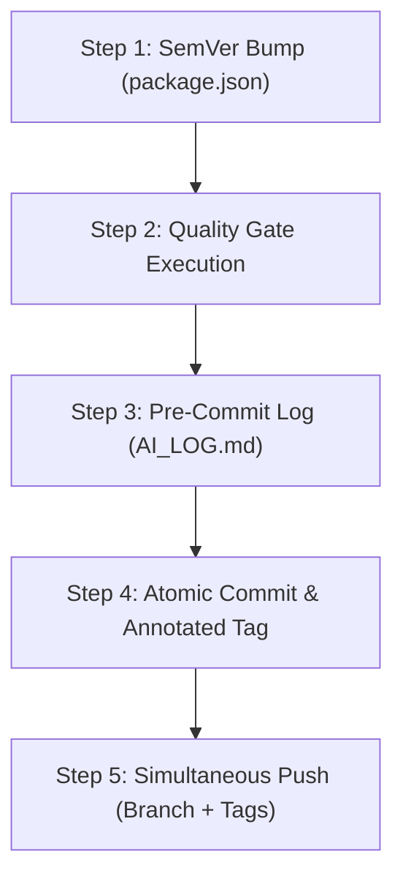

# Multi-Agent Atomic Release Protocol (`multi-agent-atomic-release`)

The definitive protocol for coordinating version releases, Git tags, CI/CD pipeline triggers, and audit logging across multiple AI assistants (Antigravity IDE, Claude Code, Gemini CLI, Cursor, Copilot).

---

## 1. The Core Release Problem & Anti-Patterns

### Common Failures in Multi-Agent Repositories
1. **Detached Log Commits**: Creating a commit solely for `AI_LOG.md` triggers redundant CI/CD builds (wasting build credits) and separates the log from the actual code changes.
2. **Version Desynchronization**: Forgetting to update `package.json` while creating a git tag `v1.2.3`, leaving production runtime metadata mismatched.
3. **Pushed Tags Without Code**: Pushing tags before commits, causing CI webhooks to build untagged or out-of-order trees.

---

## 2. The Atomic 5-Step Protocol

Whenever preparing to ship code, merge to production branches (`main`/`master`), or cut a release:



### Step 1: Synchronize Version Numbers
- Open `package.json` and bump `"version"` according to SemVer:
  - `PATCH` (`x.y.Z`): Backward-compatible bug fixes and internal refactors.
  - `MINOR` (`x.Y.0`): New features, backward-compatible enhancements.
  - `MAJOR` (`X.0.0`): Breaking changes, major architectural overhauls.

### Step 2: Quality Gate Verification
Execute all gates synchronously. All checks must return code `0`:
```bash
npm run lint && npm run build && npm test && npx playwright test
```

### Step 3: Record Audit Entry in `AI_LOG.md`
Append the release entry to `AI_LOG.md` **before** committing:
```text
[YYYY-MM-DD HH:MM] Major | <Agent_Name> | Release | vX.Y.Z - <concise description>
```

### Step 4: Atomic Commit & Annotated Git Tag
Bundle all modified code, tests, `package.json`, and `AI_LOG.md` in a single commit:
```bash
git add -A
git commit -m "chore(release): vX.Y.Z - <concise description>"
git tag -a vX.Y.Z -m "Release vX.Y.Z - <concise description>"
```

### Step 5: Simultaneous Push
Push both branch and tags in a single remote transmission:
```bash
git push origin main --tags
```

---

## 3. Shared Cross-Agent Action Logging Rules

Every assistant interacting with the repository must respect `AI_LOG.md`:

```text
[YYYY-MM-DD HH:MM] LEVEL | AGENT | TOOL | description
```

### Level Guidelines:
- **`Major`**:
  - File creations, major structural edits, refactoring.
  - Dependency additions / updates.
  - Running deployment or database migration scripts.
  - Version releases and session completions.
- **`Minor`**:
  - File reading, directory listing.
  - Code search, grep, test inspection.

### Critical Rules:
1. Append-only: Never rewrite, squash, or truncate historical lines.
2. Max 80 characters for the description field.
3. Commit bundled: Never push a standalone commit that only touches `AI_LOG.md`.
