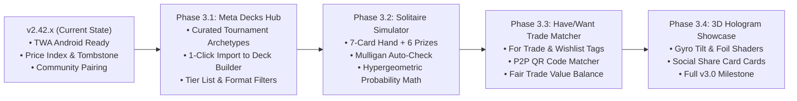

# 📌 PokeCountTracker Version 3.0 Architecture Memo & Backlog

**เอกสารบันทึกวิสัยทัศน์ สถาปัตยกรรม ฟีเจอร์ที่ทำเสร็จแล้ว และ Roadmap สู่ Version 3.0**  
*อัปเดตล่าสุด: 9 กันยายน 2026*

---

## 🎯 1. แก่นและเป้าหมายของ Version 3 (v3.0 Philosophy)
ยกระดับ PokeCountTracker จาก **เครื่องมือจดแต้มและคลังสะสม (Utility & Collection Tracker)** ก้าวสู่ **Complete Pokémon TCG Competitive & Collector Platform** ที่เชื่อมโยงระหว่างผู้เล่นและนักสะสมไทยกับมาตรฐานระดับสากลอย่างไร้รอยต่อ

---

## 🚀 2. รายการฟีเจอร์และสถานะการพัฒนาจริง (Current Status Audit)

| หมวดหมู่ฟีเจอร์ | สเปก / รายละเอียด | สถานะ | ไฟล์ / คอมโพเนนต์หลัก |
|---|---|:---:|---|
| **English Card Database** | ฐานข้อมูลการ์ดภาษาอังกฤษ 6,700+ ใบ แยกสถาปัตยกรรมแบบ On-Demand | ✅ **Completed** | `src/data/pokemonCardsEn.json`, `src/data/pokemonSetsEn.json` |
| **Thai-English Matching Engine** | เครื่องมือประมวลผลจับคู่ข้ามภาษา 4 สัญญาณ (Visual, Name, Specs, Rarity) | ✅ **Completed** | `scripts/match-thai-english-cards.mjs`, `src/data/thaiEnglishCardMap.json` |
| **Mapping Studio & Live Search** | หน้าจอตรวจสอบและจับคู่การ์ดด้วยมือ พร้อม Live Search | ✅ **Completed** | `src/components/collection/CardMappingStudioModal.tsx`, `src/components/mapping/CardMappingPage.tsx` |
| **Crowdsourced Community Mapping** | ระบบเสนอคู่การ์ดจากชุมชน + แผง Admin ตรวจสอบอนุมัติผ่าน Firestore | ✅ **Completed** | `src/services/communityPairingService.ts`, `src/components/admin/MappingApprovalPanel.tsx` |
| **PTCGL English Deck Import** | วาง Deck List สากลแล้วแปลงเป็นการ์ดไทยอัตโนมัติ | ✅ **Completed** | `src/utils/ptcglDeckParser.ts`, `src/utils/deckMapAssist.ts` |
| **Missing Cards Calculator** | ตรวจสอบเด็คเทียบกับสมุดสะสมของผู้ใช้ แจกแจงการ์ดที่ขาดและต้องหาเพิ่ม | ✅ **Completed** | `src/components/deck/MissingCardsModal.tsx`, `src/utils/deckCalculator.ts` |
| **Market Price Index Sync** | ระบบดึงราคาตลาดสากล (USD) คำนวณเป็นราคาตลาดไทย (THB) ตาม Rarity & Set | ✅ **Completed** | `src/services/pokemonPricingService.ts`, `src/store/pricingStore.ts`, `src/data/thaiPriceRatio.ts` |
| **Binder Valuation & Price Sort** | คำนวณมูลค่ารวมของสมุดสะสม และเรียงลำดับการ์ดตามมูลค่าตลาด | ✅ **Completed** | `src/components/collection/CollectionTracker.tsx` |
| **Public Shared Collection** | ระบบแชร์สมุดสะสมผ่าน Public Link และ QR Code โดยผู้เปิดดูไม่ต้องล็อกอิน | ✅ **Completed** | `src/services/sharedCollectionService.ts`, `src/components/collection/SharedCollectionView.tsx` |
| **Voice Card Collection Input** | ระบบเพิ่มการ์ดเข้าคอลเลกชันด้วยเสียงพูดภาษาไทย (Speech-to-Text) | ✅ **Completed** | `src/components/collection/VoiceCardCollectorTab.tsx`, `src/utils/voiceCardParser.ts` |
| **Cross-Device Tombstone Sync** | ป้องกัน Binder ที่ถูกลบคืนชีพข้ามอุปกรณ์เมื่อเกิด Cloud Sync | ✅ **Completed** | `src/store/collectionStore.ts` (v2.42.1) |
| **Android Trusted Web Activity** | แพ็กเกจแอปพลิเคชัน Android พร้อมขึ้น Google Play Store (AAB & APK) | ✅ **Completed** | โฟลเดอร์ `android-twa/`, `assetlinks.json` |
| **Pre-curated Live Meta Decks** | แหล่งรวมเด็คเมต้า Top Tier จากทัวร์นาเมนต์ระดับโลกในแอปแบบ 1-Click | ✅ **Completed** | `src/components/deck/MetaDecksHub.tsx`, `scripts/fetch-limitless-meta.mjs` (v2.43.0) |
| **Solitaire Playtest Simulator** | จำลองการจั่ว 7 ใบ, แจก Prize 6 ใบ, และซ้อมเล่น Turn 1-3 | ✅ **Completed** | `src/components/deck/playtest/PlaytestBoard.tsx`, `src/utils/hypergeometric.ts` (v2.44.0) |
| **Smart Have/Want Trade Matcher** | แท็ก For Trade / Wishlist และระบบจับคู่แลกการ์ด 2 ฝ่ายผ่าน QR | ⏳ **Pending** | *รอดำเนินการใน Phase 3.3* |
| **3D Holographic Showcase** | เอฟเฟกต์ 3D Gyroscope Tilt & Foil Shader สำหรับโชว์การ์ดหายาก | ⏳ **Pending** | *รอดำเนินการใน Phase 3.4* |

---

## 🗺️ 3. แผนที่นำทาง Version 3.0 (v3.0 Target Roadmap)

---

### 🏆 Phase 3.1: Live Tournament Meta Decks Hub (เมต้าสากลในคลิกเดียว)
* **เป้าหมาย**: ผู้เล่นเปิดแอปมาแล้วเจอเด็คทัวร์นาเมนต์ระดับโลกที่พร้อมใช้งานทันที ไม่ต้องไปหา Copy Text จากเว็บนอก
* **ฟีเจอร์หลัก**:
  1. **Pre-curated Meta Archetypes**:
     - รวบรวมเด็ค Tier 1 - Tier 2 ที่กำลังแข่งในเมต้าปัจจุบัน (เช่น Charizard ex, Dragapult ex, Regidrago VSTAR, Lugia VSTAR, Gardevoir ex, Raging Bolt ex, Miraidon ex, Terapagos ex)
     - จัดหมวดหมู่ตาม Tier (Tier 1, Tier 2, Rogue) และ Format (Standard Regulation F-H)
  2. **One-Tap Deck Clone**:
     - กดปุ่ม **"ใช้เด็คนี้" (Clone to My Decks)** ระบบจะสร้างเด็คภาษาไทยลงใน Deck Manager ของผู้ใช้ทันที
  3. **Auto-Missing Badge**:
     - แสดง Badge บนการ์ดของเด็คเมต้าทันทีว่า *"คุณมีการ์ดครบ 54/60 ใบ (ขาดอีก 6 ใบ)"* และกดดู Missing Cards ได้ทันที

---

### 🎮 Phase 3.2: Solitaire / Playtest Simulator (ระบบจำลองการซ้อมมือ)
* **เป้าหมาย**: ซ้อมเทิร์นแรกและทดสอบความเสถียรของเด็คโดยไม่ต้องหยิบการ์ดจริง
* **ฟีเจอร์หลัก**:
  1. **Opening Hand & Prize Setup**:
     - จำลองสุ่มจั่ว 7 ใบแรก
     - วางการ์ดรางวัล (Prize Cards) 6 ใบแบบคว่ำหน้า
     - ตรวจสอบ Mulligan อัตโนมัติ (หากไม่มี Basic Pokémon ให้กดสับจั่วใหม่ พร้อมนับจำนวนครั้งที่ Mulligan)
  2. **Turn 1-3 Goldfish Playground**:
     - ลากวางการ์ดลงตำแหน่ง Active Spot หรือ Bench
     - ฟังก์ชันค้นหากองเด็ค (Deck Search) สำหรับจำลองการใช้ Nest Ball, Buddy-Buddy Poffin, Ultra Ball
     - จั่วการ์ดตามเทิร์น (+1), ทิ้งการ์ดลง Discard Pile, ย้ายเข้า Lost Zone
  3. **Consistency Math Engine**:
     - คำนวณความน่าจะเป็นทางสถิติ (Hypergeometric Distribution):
       - โอกาสจั่วติด Basic Pokémon เทิร์นแรก (%)
       - โอกาสจั่วติด Ball Search หรือ Supporter เทิร์นแรก (%)

---

### 🤝 Phase 3.3: Smart Have/Want Trade Matcher (ระบบจับคู่แลกการ์ดอัจฉริยะ)
* **เป้าหมาย**: แลกเปลี่ยนการ์ดกับเพื่อนในร้านหรือในงานแข่งได้อย่างรวดเร็วและเป็นธรรม
* **ฟีเจอร์หลัก**:
  1. **Trade Status Tags**:
     - ในสมุดสะสม สามารถคลิกเลือกสถานะของการ์ด: `For Trade` (มีซ้ำ/ยินดีแลก) หรือ `Wishlist` (กำลังตามหา)
  2. **QR Code P2P Trade Matcher**:
     - ผู้ใช้ A แสดง QR Code สมุดสะสมของตนเอง
     - ผู้ใช้ B สแกนด้วยกล้องในแอป
     - ระบบประมวลผลเปรียบเทียบ 2 ทางทันที:
       > *"เพื่อนมีการ์ดที่คุณตามหา 3 ใบ (มูลค่า ~฿450)*  
       > *และคุณมีการ์ดที่เพื่อนต้องการ 2 ใบ (มูลค่า ~฿420)*  
       > *ดุลการแลกเปลี่ยน: ต่างกันเพียง ฿30"*
  3. **Fair Value Calculation**:
     - ดึงข้อมูลราคาตลาดจาก `pricingStore` มาช่วยสรุปมูลค่ารวมของทั้งสองฝั่ง เพื่อให้การแลกการ์ดโปร่งใสและสบายใจทั้งสองฝ่าย

---

### ✨ Phase 3.4: 3D Holographic Card Showcase & Social Sharing
* **เป้าหมาย**: ฟีเจอร์ WOW สำหรับสายสะสมในการโชว์การ์ดหายากลงโซเชียลมีเดีย
* **ฟีเจอร์หลัก**:
  1. **3D Tilt Parallax**:
     - การ์ดเอียงตามทิศทางการเลื่อนเมาส์ (Desktop) หรือเซนเซอร์ความเอียง Gyroscope (มือถือ/Android TWA)
  2. **Foil Reflection Shaders**:
     - แสงสะท้อนประกายวิบวับแบบ Holofoil / Texture SAR ตามความหายาก
  3. **Social Export Card**:
     - ส่งออกภาพกราฟิกสรุปเด็คหรือการ์ดสะสมสวยงามในสัดส่วน 9:16 (Story) หรือ 1:1 (Post) เพื่อแชร์ลง Facebook / IG / X ได้ในคลิกเดียว

---

## 📅 4. Release Milestones สรุปเวอร์ชัน

* **v2.42.x (Current - September 2026)**:
  * Admin Mapping Approval System & Community Sync
  * Binder Deletion Tombstone Protection (v2.42.1)
  * Android Trusted Web Activity (Play Store Packaging)
* **v2.43.0 (Current Release - September 2026)**:
  * Phase 3.1: Live Tournament Meta Decks Hub (24 decks, 5 playstyles, pros/cons)
  * Automated Limitless TCG weekly sync workflow
  * Enhanced Thai Card Print Selection Engine (Standard Regulation Marks G/H/I/J)
* **v2.44.0 (Current Release - September 2026)**:
  * Phase 3.2: Solitaire / Playtest Simulator (Opening Hand, 6 Prizes, Mulligan Check, Deck Search, Consistency Math)
* **v2.45.0 (Next Minor)**:
  * Phase 3.3: Have/Want Smart Trade Matcher
* **v3.0.0 (Major Release Milestone)**:
  * Phase 3.4: 3D Holographic Card Showcase + Unified Theme & Full Suite Release

---

*เอกสารฉบับนี้ถูกปรับปรุงเพื่อให้สอดคล้องกับ Codebase จริง โดยทีมพัฒนา Antigravity AI*
