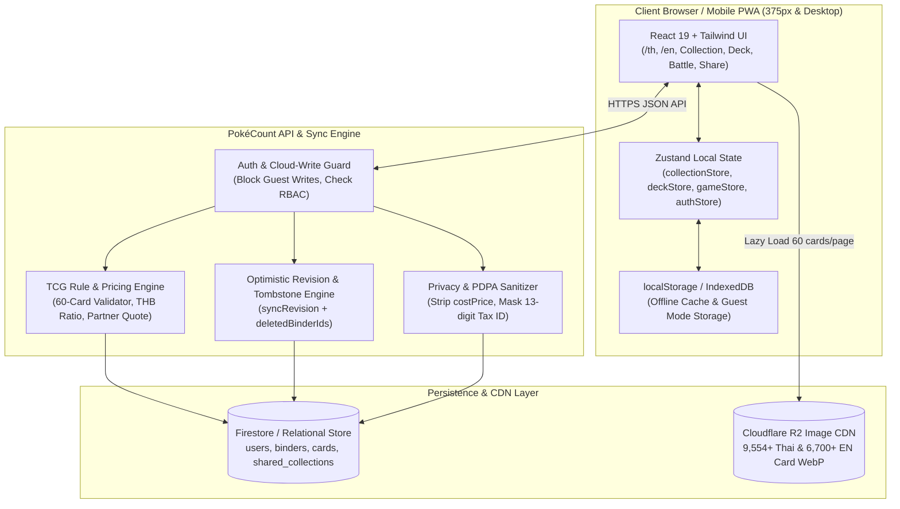
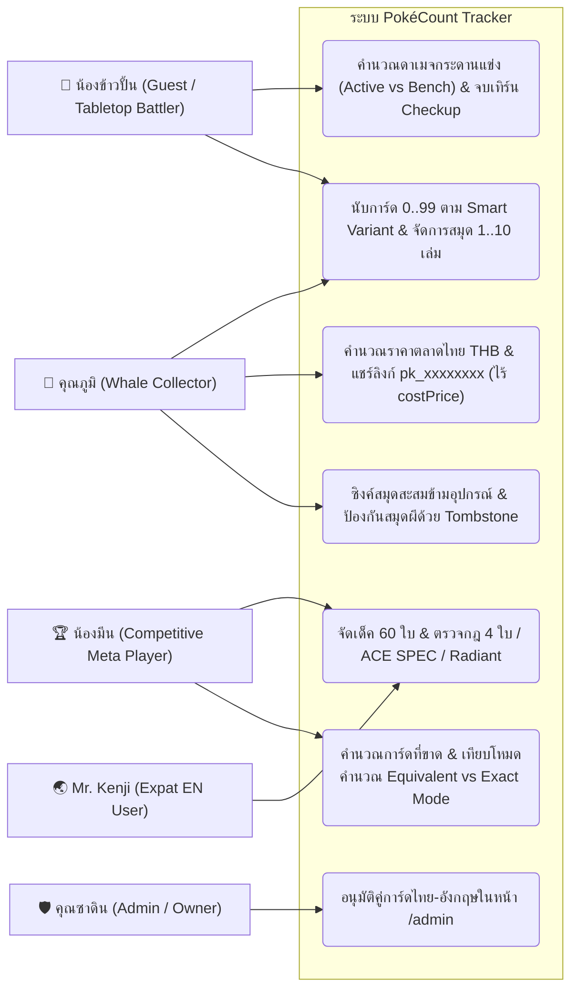
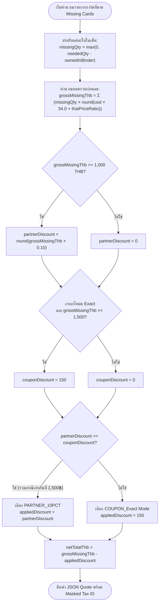
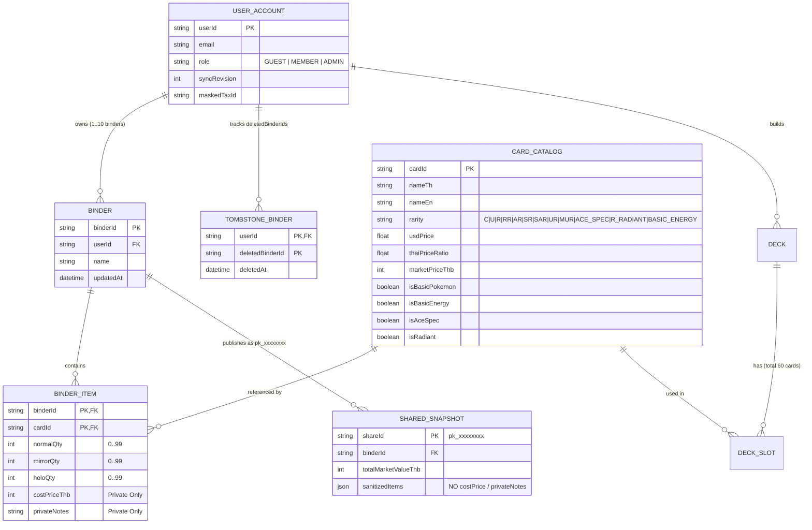
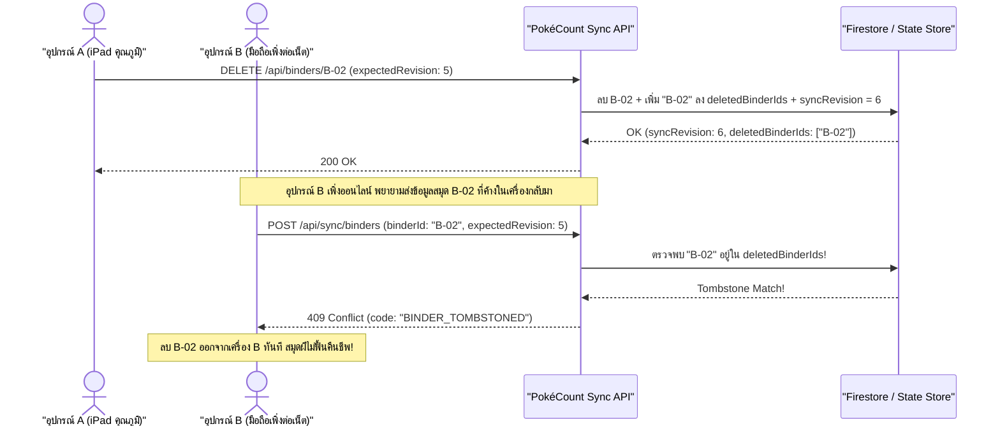

# LAB 3 · System Design (`DESIGN.md` — Architecture · Use Case · Flowchart · ERD · Sequence)

> ออกแบบระบบครบทั้ง 5 มุมมองตามแนวทางบทเรียนที่ 04 สำหรับ **`PokéCount Tracker`** โดยอ้างอิงจาก [`USER-STORIES.md`](USER-STORIES.md) และ [`REQUIREMENTS.md`](REQUIREMENTS.md)

---

## 1. สถาปัตยกรรมระบบ (`System Architecture Diagram`)

---

## 2. แผนภาพกรณีการใช้งาน (`Use Case Diagram`)

---

## 3. ผังงานการคำนวณการคำนวณการ์ดที่ขาดร้านพาร์ทเนอร์และคูปอง (`Pricing & Discount Flowchart`)

---

## 4. แผนภาพความสัมพันธ์ของข้อมูล (`Entity-Relationship Diagram — ERD`)

---

## 5. แผนภาพลำดับการทำงานและป้องกัน Race Condition (`Sequence Diagram — Cross-Device Tombstone Sync`)

