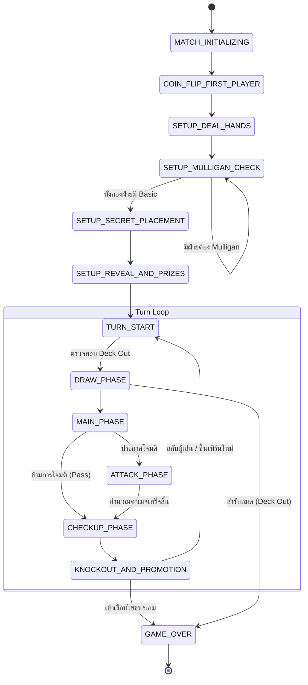

# Pokémon TCG Full Game Multiplayer System — Master Engineering Guideline
**Document Version:** 1.0.0  
**Target Product:** Full-Scale Online Multiplayer Pokémon TCG Simulator  
**Architecture:** Server-Authoritative State Machine + Fog-of-War Sync + PixiJS WebGL Client  
**Branch:** `feature/playmat-v2-pixijs`  
**Date:** September 2026  

---

## สารบัญ (Table of Contents)
1. [วิสัยทัศน์และหลักการพื้นฐาน (Vision & Core Principles)](#1-วิสัยทัศน์และหลักการพื้นฐาน)
2. [สถาปัตยกรรมระบบและเครือข่าย (System Architecture & Network Topology)](#2-สถาปัตยกรรมระบบและเครือข่าย)
   - 2.1 ทำไมต้อง Server-Authoritative (บทเรียนจากความล้มเหลวของ Client-Authoritative / P2P)
   - 2.2 โครงสร้าง Fog-of-War (ความปลอดภัยและการปิดบังข้อมูล)
   - 2.3 การสื่อสารแบบ Real-time (WebSockets / WebRTC DataChannels)
   - 2.4 การจัดการ Disconnect, Reconnect & Match Clock
3. [ระบบประมวลผลการ์ดและเอฟเฟกต์ (Card Mechanics & Effect Engine DSL)](#3-ระบบประมวลผลการ์ดและเอฟเฟกต์)
   - 3.1 ความท้าทายของการ์ด 9,500+ ใบ และทางออกเชิงสถาปัตยกรรม
   - 3.2 Declarative Effect Primitive DSL (ภาษาอธิบายเอฟเฟกต์)
   - 3.3 Interactive Decision Request/Response Pipeline (ระบบโต้ตอบผู้เล่น)
4. [วงจรชีวิตและเครื่องจักรสถานะของเกม (Game Lifecycle & State Machine)](#4-วงจรชีวิตและเครื่องจักรสถานะของเกม)
   - 4.1 State Hierarchy (โมเดลสถานะทั้งระบบ)
   - 4.2 วงจร Mulligan แบบ Concurrent
   - 4.3 Action Validation & Command Resolution Pipeline
   - 4.4 Automated Checkup & Prize Resolution Subsystem
5. [กราฟิกและการแสดงผลฝั่ง Client (PixiJS View & Interaction Layer)](#5-กราฟิกและการแสดงผลฝั่ง-client)
   - 5.1 สถาปัตยกรรม Reactive Consumer
   - 5.2 Scene Graph & Layer Hierarchy
   - 5.3 Animation Tween Queue & Action Interpolation
   - 5.4 Virtual Coordinate Resolution & Multi-Device Scaling
6. [ยุทธศาสตร์การทดสอบและการประกันคุณภาพแบบครบวงจร (End-to-End QA Strategy)](#6-ยุทธศาสตร์การทดสอบและการประกันคุณภาพแบบครบวงจร)
   - 6.1 Level 1: Vitest Pure State Machine Unit Tests
   - 6.2 Level 2: Headless Bot Simulation (Stress Testing & Chaos Engine)
   - 6.3 Level 3: Dual-Client Playwright E2E Tests
   - 6.4 Level 4: Network Degradation & Disconnect/Reconnect Tests
7. [แผนที่การพัฒนาแบบแบ่งเฟส (Phased Implementation Roadmap)](#7-แผนที่การพัฒนาแบบแบ่งเฟส)

---

## 1. วิสัยทัศน์และหลักการพื้นฐาน (Vision & Core Principles)

การสร้างเกม Pokémon TCG ออนไลน์ที่สมบูรณ์แบบระดับแข่งขัน ไม่ใช่แค่การวาดรูปการ์ดลงบนจอ แต่คือการสร้าง **"ระบบจำลองทางคณิตศาสตร์และตรรกะที่ปราศจากข้อผิดพลาด (Zero-Defect Deterministic Engine)"**

### หลักการ 5 ข้อที่ไม่สามารถประนีประนอมได้ (The 5 Non-Negotiable Pillars):
1. **Server-Authoritative Only (เซิร์ฟเวอร์เป็นผู้ตัดสินสูงสุด)**:
   Client มีหน้าที่เพียงแค่ "ส่งเจตจำนง (Intention)" และ "วาดภาพผลลัพธ์ (Render Outcome)" ห้ามให้ Client มีสิทธิ์เปลี่ยนแปลงตัวเลข HP, การจั่วการ์ด หรือตำแหน่งการ์ดโดยตรงเด็ดขาด
2. **Absolute Fog-of-War (ปิดบังข้อมูลลับ 100%)**:
   การ์ดบนมือคู่แข่ง, การ์ดในสำรับที่ยังไม่ได้เปิดดู, และการ์ดรางวัล (Prize Cards) ที่คว่ำหน้าอยู่ จะ **ไม่ถูกส่งเนื้อหาจริง (Card ID/Artwork) ไปยังเครื่อง Client ของฝ่ายตรงข้าม** ก่อนที่จะมีเอฟเฟกต์สั่งให้เปิดดูอย่างเป็นทางการ ป้องกันการโกงผ่าน Chrome DevTools Network Tab 100%
3. **Pure Deterministic State Machine**:
   ตรรกะของเกมแยกตัวออกจาก UI, React, Canvas, DOM โดยสิ้นเชิง สามารถรันแบบ Headless ใน Node.js เพื่อทดสอบกับ AI Bot ได้นับแสนแมตช์โดยไม่ต้องเปิด Browser
4. **60–120 FPS Fluid Graphics (PixiJS WebGL)**:
   การ์ดทุกใบ, พลังงานที่ติดอยู่ (Attachments), เคาน์เตอร์ดาเมจ, และเอฟเฟกต์แสงเงา ต้องรันบน WebGL ด้วยโครงสร้าง Scene Graph ที่มีประสิทธิภาพสูง
5. **Reconnection & Crash Resilient**:
   หากสัญญาณอินเทอร์เน็ตหลุด หรือ Refresh เบราว์เซอร์ ผู้เล่นสามารถกลับเข้ามาในห้องเดิมและกู้คืนสถานะเกมกลับมาได้ครบถ้วนภายใน 30 วินาที

---

## 2. สถาปัตยกรรมระบบและเครือข่าย (System Architecture & Network Topology)

```
┌─────────────────────────────────────────────────────────────────────────────┐
│                              Server Authority                               │
│  (Node.js Room Worker / Durable Object / Secure State Machine)              │
│                                                                             │
│  ┌───────────────────────┐   Action   ┌──────────────────────────────────┐  │
│  │ Master Game State     │◄───────────┤ Room Action Validator & Engine   │  │
│  │ (Full Unmasked Truth) │            │ (Validates Rules, RNG, Triggers) │  │
│  └──────────┬────────────┘            └──────────────────────────────────┘  │
│             │                                                               │
│             │ State Masking / Fog-of-War Filtering                          │
│             ▼                                                               │
│      ┌──────────────┐                ┌──────────────┐                       │
│      │ Player 0 View│                │ Player 1 View│                       │
│      │  (Filtered)  │                │  (Filtered)  │                       │
└──────┴──────┬───────┴────────────────┴──────┬───────┴───────────────────────┘
              │ WebSocket / WebRTC            │ WebSocket / WebRTC
              ▼                               ▼
       ┌──────────────┐                ┌──────────────┐
       │ Client 0     │                │ Client 1     │
       │ (PixiJS View)│                │ (PixiJS View)│
       └──────────────┘                └──────────────┘
```

### 2.1 บทเรียนจาก Client-Authoritative / Simple Firestore Sync
ใน Prototype v1 การใช้ Firestore/BroadcastChannel แบบส่ง Object ทั้งก้อนข้ามไปมา ทำให้พบปัญหา:
- **Race Condition**: เมื่อผู้เล่น 2 คนขยับการ์ดพร้อมกัน เกิดการ Overwrite ข้อมูลทับกัน
- **Desync & State Mutation**: Client ฝั่งหนึ่งคำนวณดาเมจผิด ทำให้อีกฝั่งเห็นเลือดไม่ตรงกัน
- **Cheat Vulnerability**: หากเปิดดู Document ใน Firestore จะเห็นการ์ดบนมือและการ์ดรางวัลทั้งหมดของคู่แข่ง

**สถาปัตยกรรม Full Game จึงต้องเป็น Server-Authoritative**:
- มี **Room Worker** ประจำแต่ละห้อง
- Client ส่งเฉพาะคำสั่งสั้นๆ (e.g. `{ type: 'ATTACH_ENERGY', cardInstanceId: 'c12', targetPokemonId: 'p1' }`)
- Server ตรวจสอบกฎ หากผ่าน จะอัปเดต Master State และกระจายการเปลี่ยนแปลงให้ทั้งสองฝั่ง

### 2.2 โครงสร้าง Fog-of-War (State Masking)
เซิร์ฟเวอร์จะเก็บ **MasterGameState** ที่รู้ข้อมูลทั้งหมด 100% แต่เมื่อแปลงเป็นข้อมูลส่งให้ Client จะผ่านฟังก์ชัน `maskStateForPlayer(masterState, playerIndex)`:

| ข้อมูลในสนาม | มุมมองของเจ้าของการ์ด (Owner) | มุมมองของฝ่ายตรงข้าม (Opponent) |
| :--- | :--- | :--- |
| **การ์ดบนมือ (Hand)** | เห็นครบทั้ง ID, รูป, ชนิด, ชื่อ | ส่งไปเฉพาะ `instanceId` และ `{ isFacedown: true }` (ไม่รู้ว่าคือการ์ดอะไร) |
| **การ์ดในสำรับ (Deck)** | รู้จำนวนใบที่เหลือ (ห้ามดูเนื้อหา เว้นแต่มีเอฟเฟกต์ Search) | รู้จำนวนใบที่เหลือ (ห้ามดูเนื้อหา) |
| **การ์ดรางวัล (Prizes)** | เห็นเฉพาะการ์ดคว่ำ 6 ใบ | เห็นเฉพาะการ์ดคว่ำ 6 ใบ |
| **Active & Bench** | เปิดเผยข้อมูลครบถ้วน | เปิดเผยข้อมูลครบถ้วน |
| **Discard Pile** | เปิดเผยข้อมูลครบถ้วน (Public Zone) | เปิดเผยข้อมูลครบถ้วน (Public Zone) |
| **Lost Zone** | เปิดเผยข้อมูลครบถ้วน (Public Zone) | เปิดเผยข้อมูลครบถ้วน (Public Zone) |

### 2.3 การสื่อสารแบบ Real-time
- **Transport**: WebSockets (ผ่าน Socket.io / Fastify WebSocket หรือ Cloudflare Durable Objects WebSocket)
- **Message Format**: Binary Protocol (MessagePack หรือ Protobuf) เพื่อความรวดเร็วและใช้แบนด์วิธต่ำ หรือ JSON สำหรับระยะ Prototype
- **Message Types**:
  - `ACTION_SUBMIT`: Client ➔ Server
  - `ACTION_REJECTED`: Server ➔ Client (พร้อม Error Code / เหตุผลที่ผิดกติกา)
  - `STATE_DELTA`: Server ➔ All Clients (การเปลี่ยนแปลงสถานะเฉพาะจุด)
  - `PROMPT_REQUEST`: Server ➔ Specific Client (ขอการตัดสินใจ เช่น "เลือกทิ้งการ์ด 2 ใบ")
  - `PROMPT_RESPONSE`: Specific Client ➔ Server (คำตอบของผู้เล่น)

### 2.4 การจัดการ Disconnect, Reconnect & Match Clock
- **Chess Clock System**: แต่ละคนมีเวลาการแข่งขันรวม (เช่น คนละ 25 นาที) + เวลาประจำเทิร์น (Turn Timer 75 วินาที)
- **Disconnect Buffer (30 วินาที)**: หาก Client ขาดการเชื่อมต่อ เกมจะเข้าสู่โหมด `PAUSED_FOR_DISCONNECT` และจับเวลารอ 30 วินาที หากเชื่อมต่อกลับมาทันเวลา เกมจะเล่นต่อได้ทันที หากเกินเวลา จะถือว่า **Concede (แพ้บาย)**
- **Snapshot Sync**: เมื่อ Reconnect กลับมา Client จะได้รับ Full State Snapshot ปัจจุบันทันที ทำให้ฟื้นฟูกระดานกลับมาเล่นต่อได้ภายใน 1 วินาที

---

## 3. ระบบประมวลผลการ์ดและเอฟเฟกต์ (Card Mechanics & Effect Engine DSL)

### 3.1 ปัญหาของการ์ด 9,500+ ใบ
หากเขียนโค้ด `if-else` แยกการ์ดแต่ละใบ จะเกิดหนี้ทางเทคนิค (Technical Debt) มหาศาลและไม่สามารถดูแลได้ การ์ดส่วนใหญ่ใน Pokémon TCG สร้างขึ้นจาก **พฤติกรรมพื้นฐานซ้ำๆ (Primitive Behaviors)**

### 3.2 Declarative Effect Primitive DSL
เราจะสร้างระบบจำแนกประเภทเอฟเฟกต์ (Effect Primitives) ที่นำมาประกอบกันแบบ Block Building:

```typescript
export type TargetSelector = 
  | 'SELF_ACTIVE'
  | 'SELF_BENCH'
  | 'OPPONENT_ACTIVE'
  | 'OPPONENT_BENCH'
  | 'ALL_OPPONENT_POKEMON'
  | 'ANY_POKEMON_IN_PLAY';

export type CardFilter = {
  supertype?: 'Pokemon' | 'Trainer' | 'Energy';
  subtypes?: string[];       // ['Basic'], ['Supporter'], ['Item'], etc.
  energyType?: string;       // 'Fire', 'Water', etc.
  maxHp?: number;
  nameContains?: string;
};

export type EffectPrimitive = 
  | { type: 'DRAW_CARDS'; amount: number }
  | { type: 'SEARCH_DECK'; filter: CardFilter; minCount: number; maxCount: number; destination: 'HAND' | 'BENCH' | 'ACTIVE' | 'DISCARD' }
  | { type: 'ATTACH_ENERGY_FROM_DISCARD'; filter: CardFilter; target: TargetSelector; count: number }
  | { type: 'DISCARD_FROM_HAND'; count: number; filter?: CardFilter }
  | { type: 'APPLY_DAMAGE'; baseAmount: number; perEnergyMultiplier?: { type: string; amount: number }; coinMultiplier?: { headsAmount: number } }
  | { type: 'HEAL_DAMAGE'; target: TargetSelector; amount: number }
  | { type: 'APPLY_SPECIAL_CONDITION'; target: TargetSelector; condition: 'POISON' | 'BURN' | 'ASLEEP' | 'PARALYZED' | 'CONFUSED' }
  | { type: 'SWITCH_DEFENDING_WITH_BENCH' }
  | { type: 'COIN_FLIP'; count: number; onSuccess: EffectPrimitive[]; onFailure?: EffectPrimitive[] };
```

#### ตัวอย่างการแปลงการ์ดจริงเป็น DSL:
- **Ultra Ball (ไฮเปอร์บอล)**:
  ```json
  {
    "cost": [{ "type": "DISCARD_FROM_HAND", "count": 2 }],
    "effect": [{ "type": "SEARCH_DECK", "filter": { "supertype": "Pokemon" }, "minCount": 0, "maxCount": 1, "destination": "HAND" }]
  }
  ```
- **Professor's Research (งานวิจัยของศาสตราจารย์)**:
  ```json
  {
    "effect": [
      { "type": "DISCARD_ENTIRE_HAND" },
      { "type": "DRAW_CARDS", "amount": 7 }
    ]
  }
  ```
- **Boss's Orders (คำสั่งของบอส)**:
  ```json
  {
    "effect": [
      { "type": "CHOOSE_TARGET", "selector": "OPPONENT_BENCH", "count": 1 },
      { "type": "SWITCH_WITH_ACTIVE" }
    ]
  }
  ```

### 3.3 Interactive Decision Request/Response Pipeline
เมื่อการ์ดต้องการให้ผู้เล่น "เลือก" (เช่น เลือกการ์ดจากเด็ค, เลือกเป้าหมายบนเบนช์):
1. เซิร์ฟเวอร์หยุดการประมวลผลไว้ที่ Execution Frame ปัจจุบัน
2. ส่งคำสั่ง `PROMPT_USER` ไปยัง Client เฉพาะคนที่มีสิทธิ์ตัดสินใจ
3. Client เปิดหน้าต่าง UI ให้ผู้ใช้กดเลือก
4. Client ส่งผลลัพธ์กลับมา (`PROMPT_RESPONSE`)
5. เซิร์ฟเวอร์ตรวจสอบความถูกต้องของการเลือก (ห้ามเลือกการ์ดที่ไม่อยู่ในเงื่อนไข Filter) แล้วประมวลผลขั้นต่อไปจนจบ

---

## 4. วงจรชีวิตและเครื่องจักรสถานะของเกม (Game Lifecycle & State Machine)



### 4.1 ตารางตรวจสอบสิทธิ์ในแต่ละเฟส (Phase Permission Matrix)

| แอ็กชัน (Action) | Draw Phase | Main Phase | Attack Phase | Checkup |
| :--- | :---: | :---: | :---: | :---: |
| **ลง Basic บน Bench** | ❌ | ✅ (ถ้า Bench ไม่เต็ม) | ❌ | ❌ |
| **พัฒนาร่าง (Evolve)** | ❌ | ✅ (ตามกฎเทิร์น) | ❌ | ❌ |
| **ติด Energy จากมือ** | ❌ | ✅ (1 ครั้ง/เทิร์น) | ❌ | ❌ |
| **เล่น Item** | ❌ | ✅ (ไม่จำกัด) | ❌ | ❌ |
| **เล่น Supporter** | ❌ | ✅ (1 ใบ/เทิร์น, ห้าม T1 P1) | ❌ | ❌ |
| **สั่งถอยหนี (Retreat)** | ❌ | ✅ (1 ครั้ง/เทิร์น, ห้ามถ้าหลับ/ชา) | ❌ | ❌ |
| **ใช้ Ability** | ❌ | ✅ (ตามข้อกำหนดการ์ด) | ❌ | ❌ |
| **สั่งโจมตี (Attack)** | ❌ | ❌ | ✅ (ห้าม T1 P1) | ❌ |
| **คำนวณพิษ/ไฟไหม้** | ❌ | ❌ | ❌ | ✅ (อัตโนมัติ) |

---

## 5. กราฟิกและการแสดงผลฝั่ง Client (PixiJS View & Interaction Layer)

### 5.1 สถาปัตยกรรมแบบ Reactive Consumer
ฝั่ง Client จะแบ่งงานออกเป็น 2 ระดับอย่างชัดเจน:
1. **React UI Shell**:
   - ควบคุมหน้าต่างรอบนอก: กล่องแชท, ปุ่ม Concede, ปุ่ม Settings, นาฬิกาจับเวลา, หน้าต่างเลือกการ์ดในเด็ค (Deck Search Modal)
2. **PixiJS Game Canvas**:
   - ควบคุมการวาดกระดาน, การลากการ์ด, การเคลื่อนที่แบบฟิสิกส์ 60 FPS, การแสดงการ์ดพลังงานที่ติดอยู่, แอนิเมชันลูกเต๋าดาเมจ

```
┌────────────────────────────────────────────────────────┐
│               Client Architecture                       │
│                                                        │
│   ┌────────────────────────────────────────────────┐   │
│   │ React Shell UI (Modals, Timers, Chat, Overlay) │   │
│   └───────────────────────┬────────────────────────┘   │
│                           │ Events                     │
│                           ▼                            │
│   ┌────────────────────────────────────────────────┐   │
│   │ PixiJS WebGL Stage (1920x1080 Virtual Canvas)  │   │
│   │                                                │   │
│   │   [Opponent Bench & Active (Rotated 180°)]     │   │
│   │   [Stadium & Battle Effects Layer]             │   │
│   │   [Player Active & Bench (Interactive 0°)]     │   │
│   │   [Player Hand Layer (Draggable Curve)]        │   │
│   └────────────────────────────────────────────────┘   │
└────────────────────────────────────────────────────────┘
```

### 5.2 Scene Graph & Layer Hierarchy (แก้ปัญหา Energy หลุดถาวร)
ทุกการ์ดโปเกมอนที่อยู่บนกระดาน จะมีโครงสร้าง Scene Graph ดังนี้:
```
CardEntityContainer (Container หลัก)
  ├── DragHitArea (พื้นที่รับสัมผัสกว้างพิเศษ ป้องกันการหลุดนิ้ว)
  ├── EnergyCascadeLayer (Container พลังงาน ซ้อนเยื้องลงล่างทีละ 15px)
  │     ├── EnergySprite 1
  │     └── EnergySprite 2
  ├── BaseCardSprite (รูปการ์ดหลัก มี Mask ขอบมน และ Shimmer Shader ถ้าเป็นการ์ดฟอยล์)
  ├── ToolAttachmentSprite (รูปไอเทม Tool แปะมุมขวาบน)
  ├── DamageDiceBadge (ตัวแสดงตัวเลขดาเมจ ปรับขนาดตามแต้ม)
  └── StatusOverlay (ไอคอนไฟไหม้ / พิษ / ตัวบอกสถานะหลับที่หมุนการ์ด 90 องศา)
```
*ประโยชน์มหาศาล*: เมื่อย้ายตำแหน่ง `CardEntityContainer` การ์ดพลังงาน, ไอเทม และแต้มดาเมจทั้งหมดจะเคลื่อนที่ตามไปด้วยกันทันทีในระดับ GPU Matrix!

### 5.3 Virtual Coordinate System (1920x1080)
- กำหนดขนาดตรรกะของกระดานไว้ที่ `1920 x 1080` (อัตราส่วน 16:9)
- มีฟังก์ชันคำนวณ Viewport Fit:
  ```typescript
  function updateViewport(app: Application, screenWidth: number, screenHeight: number) {
    const scale = Math.min(screenWidth / 1920, screenHeight / 1080);
    app.stage.scale.set(scale);
    app.stage.x = (screenWidth - 1920 * scale) / 2;
    app.stage.y = (screenHeight - 1080 * scale) / 2;
  }
  ```
- ไม่ว่าผู้เล่นจะเปิดบน iPad (4:3), จอคอม (16:9), หรือมือถือ (19.5:9) ภาพและตำแหน่งโซนการ์ดจะตรงเป๊ะ ไม่บิดเบี้ยว ไม่เพี้ยน

---

## 6. ยุทธศาสตร์การทดสอบและการประกันคุณภาพแบบครบวงจร (End-to-End QA Strategy)

เกมการ์ด TCG มีความซับซ้อนของ State สูงมาก จึงต้องใช้การทดสอบ 4 ระดับ เพื่อการันตีว่าจะ **ไม่มีการเกิด Game Freeze หรือ State Desync บน Production**:

### 6.1 Level 1: Vitest Pure State Machine Unit Tests (Rule Coverage 100%)
- ทดสอบกฎกติกามากกว่า 150+ Test Cases โดยไม่เปิด Browser
- ครอบคลุม:
  - การลงการ์ดผิดเฟส ➔ ต้อง Reject
  - การเล่น Supporter ใบที่ 2 ในเทิร์น ➔ ต้อง Reject
  - ผู้เล่นคนแรกโจมตีในเทิร์น 1 ➔ ต้อง Reject
  - การคำนวณ Weakness x2 และ Resistance -30
  - การน็อคเอาท์และการแจกการ์ดรางวัลตามประเภทการ์ด (ex vs Normal)
  - การคำนวณสภาวะผิดปกติในรอบ Checkup

### 6.2 Level 2: Headless Bot Simulation (Stress & Chaos Engine)
- สร้าง **Random Action Simulation Bot** 2 ตัว
- ให้บอทสุ่มเลือกแอ็กชันที่ถูกต้องตามกฎ (Valid Actions) และแข่งกันเองใน Node.js
- **เป้าหมาย**: รันการแข่งขันจำลอง **1,000 แมตช์ติดต่อกัน** ใน CI/CD:
  - ต้องไม่มีแมตช์ใดเกิด Infinite Loop หรือ Game Lock
  - ทุกแมตช์ต้องจบลงด้วย Win Condition ที่ถูกต้อง (Prizes / Bench Out / Deck Out) เสมอ

### 6.3 Level 3: Dual-Client Playwright E2E Tests
- เปิด 2 Browser Contexts พร้อมกันใน Playwright (Player 1 และ Player 2)
- ให้ Player 1 เข้าห้อง และ Player 2 กด Join เข้ามา
- ทดสอบ:
  - Player 1 ลากการ์ด Active ➔ Player 2 ต้องเห็นการ์ดเคลื่อนที่แบบ Smooth ภายในเวลาไม่เกิน 100ms
  - ตรวจสอบ Network Payload: ตรวจดูว่า Player 2 มองไม่เห็น Card ID ของการ์ดบนมือ Player 1 (ยืนยัน Fog-of-War)
  - ทดสอบการจั่วการ์ดรางวัล และการขึ้นป้าย Victory/Defeat เมื่อจบเกม

### 6.4 Level 4: Network Degradation & Reconnection Tests
- ใช้ Playwright Network Emulation:
  - จำลอง Latency 300ms + Packet Loss 5%
  - จำลองการตัดเน็ต (Offline) กลางเกม 10 วินาที แล้วต่อใหม่
  - ยืนยันว่าเกมสามารถ Reconnect ดึง State Snapshot กลับมาและเล่นต่อได้ปกติ 100%

---

## 7. แผนที่การพัฒนาแบบแบ่งเฟส (Phased Implementation Roadmap)

```
┌────────────────────────────────────────────────────────────────────────┐
│ Phase 1: The Rule & State Engine (Week 1-2)                            │
│ - สถาปัตยกรรม State Machine (Pure TypeScript)                         │
│ - ระบบ Action Validator ครบทุกกฎกติกา Standard                        │
│ - Vitest Rule Test Suites ครอบคลุม 100%                                │
└───────────────────────────────────┬────────────────────────────────────┘
                                    │
┌───────────────────────────────────▼────────────────────────────────────┐
│ Phase 2: Card DSL & Core Deck Implementation (Week 3)                  │
│ - สร้าง Effect Primitive DSL                                           │
│ - เขียนนิยามเอฟเฟกต์สำหรับการ์ดใน Starter Decks 2 สำรับ               │
│   (เช่น Charizard ex vs Miraidon ex)                                   │
│ - Headless Bot Simulation 1,000 แมตช์                                  │
└───────────────────────────────────┬────────────────────────────────────┘
                                    │
┌───────────────────────────────────▼────────────────────────────────────┐
│ Phase 3: PixiJS WebGL Single-Player Board (Week 4-5)                   │
│ - ออกแบบ Virtual Canvas 1920x1080 พร้อม Responsive Fit                 │
│ - สร้าง CardEntityContainer Scene Graph (Card + Energy + Dice)         │
│ - ระบบ Drag & Drop, Zone Snap, และ Radial Action Menu บน Canvas        │
│ - เปิดทดสอบ Sandbox ในเส้นทางซ่อน `/playmat-v2`                        │
└───────────────────────────────────┬────────────────────────────────────┘
                                    │
┌───────────────────────────────────▼────────────────────────────────────┐
│ Phase 4: Authoritative Room Server & Fog-of-War Sync (Week 6-7)        │
│ - สร้าง Room Worker จัดการ State และ Filter Fog-of-War                 │
│ - เชื่อมต่อ WebSocket สองฝั่ง ส่ง Action ➔ Validate ➔ Broadcast Delta  │
│ - ระบบ Prompt Interactive Decision (เลือกการ์ดจากเด็ค/เบนช์)          │
└───────────────────────────────────┬────────────────────────────────────┘
                                    │
┌───────────────────────────────────▼────────────────────────────────────┐
│ Phase 5: Production Readiness & Quality Assurance (Week 8)             │
│ - ระบบ Chess Clock, Reconnect 30s Buffer, ป้องกันการตัดเน็ต            │
│ - Dual-Client Playwright Automated E2E Testing                         │
│ - ตรวจสอบความเรียบร้อยรอบสุดท้ายร่วมกับผู้ใช้ ก่อนพิจารณาขึ้น Production│
└────────────────────────────────────────────────────────────────────────┘
```

---
*เอกสารฉบับนี้เป็นแนวทางแม่บทสูงสุด (Master Guideline) สำหรับการพัฒนาเกม Pokémon TCG แบบ Multiplayer ครบวงจร โดยทุกการพัฒนาจะดำเนินงานบน Feature Branch อย่างเคร่งครัด*
