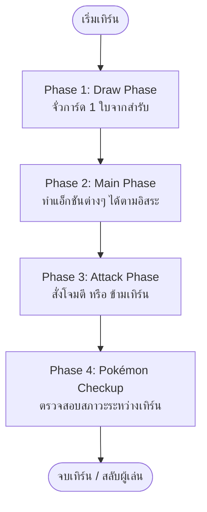

# Pokémon TCG Standard Format — Game System & Engineering Playbook
**Document Version:** 1.0.0  
**Target Engine:** Pokémon TCG Digital Playmat v2 (Pure State Machine + PixiJS WebGL View)  
**Branch:** `feature/playmat-v2-pixijs`  
**Date:** September 2026  

---

## สารบัญ (Table of Contents)
1. [บทนำและวัตถุประสงค์ (Introduction & Purpose)](#1-บทนำและวัตถุประสงค์)
2. [กฎและข้อกำหนด Standard Format ฉบับทางการ (Official Standard Rules Specification)](#2-กฎและข้อกำหนด-standard-format-ฉบับทางการ)
   - 2.1 โครงสร้างสำรับการ์ด (Deck Construction)
   - 2.2 ขั้นตอนการเริ่มเกมและการเซ็ตอัป (Game Setup & Mulligan)
   - 2.3 โครงสร้างเทิร์นอย่างละเอียด (Turn Phases & Action Economy)
   - 2.4 การเล่นการ์ดและข้อจำกัดในเทิร์น (Card Play Rules & Limitations)
   - 2.5 การต่อสู้และการคำนวณดาเมจ (Attack Phase & Damage Resolution)
   - 2.6 สภาวะผิดปกติและการตรวจสอบระหว่างเทิร์น (Special Conditions & Pokémon Checkup)
   - 2.7 เงื่อนไขการแพ้-ชนะ (Win & Loss Conditions)
3. [สถาปัตยกรรมระบบเกมเชิงวิศวกรรม (Game System Architecture)](#3-สถาปัตยกรรมระบบเกมเชิงวิศวกรรม)
   - 3.1 ปรัชญาการออกแบบ: Pure Deterministic Finite State Machine (FSM)
   - 3.2 โครงสร้างข้อมูลและโมเดลสถานะ (Data Contracts & State Schemas)
   - 3.3 ระบบตรวจจับกฎและความถูกต้อง (Action Validator Engine)
   - 3.4 ท่อประมวลผลคำสั่งและบันทึกเหตุการณ์ (Command Pipeline & Action Log)
4. [การเชื่อมโยงสู่กราฟิกส์ WebGL (PixiJS View Layer Integration)](#4-การเชื่อมโยงสู่กราฟิกส์-webgl-pixijs-view-layer)
   - 4.1 สถาปัตยกรรมแบบ Reactive Consumer (ไร้การผูกมัด)
   - 4.2 ระบบพิกัดเสมือน (Virtual Coordinate System 1920x1080)
   - 4.3 โครงสร้าง Scene Graph และลำดับขั้นการ์ด (Hierarchical Scene Graph)
5. [กลยุทธ์การทดสอบและการการันตีคุณภาพ (Testing & Verification Strategy)](#5-กลยุทธ์การทดสอบและการการันตีคุณภาพ)
   - 5.1 Test-Driven Rule Coverage (Vitest Unit Tests)
   - 5.2 Scenario Replay Engine (Integration Tests)
6. [แผนการพัฒนาทีละระยะ (Implementation Roadmap)](#6-แผนการพัฒนาทีละระยะ)

---

## 1. บทนำและวัตถุประสงค์

Playbook เล่มนี้จัดทำขึ้นเพื่อเป็น **พิมพ์เขียวทางวิศวกรรม (Engineering Blueprint)** และ **คู่มือกติกาเกมที่เป็นทางการ** สำหรับการสร้างระบบกระดานดิจิทัล (Digital Playmat) ในเวอร์ชันถัดไป โดยมีเป้าหมายเพื่อ:
1. กำหนดกฎและกติกาของเกม Pokémon TCG ในรูปแบบ **Standard Format** อย่างสมบูรณ์ แม่นยำ และครอบคลุมทุก Edge Case
2. วางโครงสร้างสถาปัตยกรรมระบบเกมแบบ **Deterministic State Machine (เครื่องจักรสถานะแบบจำลองแน่นอน)** ที่แยกตรรกะของเกม (Game Logic) ออกจากส่วนแสดงผล (View Engine) โดยสิ้นเชิง 100%
3. ใช้เป็นแนวทางก่อนลงมือเขียนโค้ด เพื่อป้องกันปัญหาความสับสน, Logic Error หรือข้อจำกัดด้าน Performance ที่เคยเกิดขึ้นในเวอร์ชัน DOM Prototype

---

## 2. กฎและข้อกำหนด Standard Format ฉบับทางการ

### 2.1 โครงสร้างสำรับการ์ด (Deck Construction)
- **จำนวนการ์ด**: ต้องมี **60 ใบพอดี** (ไม่ขาดและไม่เกิน)
- **กฎ 4 ใบ (Rule of 4)**: การ์ดที่มีชื่อภาษาอังกฤษ/ไทยเดียวกัน ใส่ได้ไม่เกิน **4 ใบ** ต่อหนึ่งสำรับ (ยกเว้น Basic Energy ที่ใส่ได้ไม่จำกัด)
- **สัญลักษณ์ Regulation Mark**: อนุญาตเฉพาะการ์ดที่มีตรา **H, I, J** (รวมถึงชุดใหม่ล่าสุดอย่าง Series J / MA6)
- **การ์ดประเภทพิเศษ (Special Card Constraints)**:
  - **ACE SPEC**: ใส่ได้สูงสุด **1 ใบเท่านั้น** ต่อสำรับ (นับรวมทุกประเภท ทั้ง Item, Tool, Energy, Stadium)
  - **Radiant Pokémon**: ใส่ได้สูงสุด **1 ตัวเท่านั้น** ต่อสำรับ

---

### 2.2 ขั้นตอนการเริ่มเกมและการเซ็ตอัป (Game Setup & Mulligan)
1. **โยนเหรียญเสี่ยงทาย (Coin Flip / Randomizer)**:
   - ผู้ชนะการเสี่ยงทายเลือกว่าจะเป็น **ผู้เล่นคนแรก (First Player)** หรือ **ผู้เล่นคนที่สอง (Second Player)**
2. **จั่วการ์ดเริ่มต้น (Draw Opening Hand)**:
   - ผู้เล่นทั้งสองจั่วการ์ดคนละ **7 ใบ**
3. **ขั้นตอนการคัดกรองมัลลิแกน (Mulligan Procedure)**:
   - หากผู้เล่นไม่มี **Basic Pokémon** บนมือเลยแม้แต่ตัวเดียว ต้องประกาศ **Mulligan**:
     - แสดงการ์ดบนมือให้อีกฝ่ายดู
     - สับการ์ดบนมือทั้งหมดกลับเข้าสำรับ แล้วจั่วใหม่ 7 ใบ
     - ทำซ้ำจนกว่าจะได้ Basic Pokémon
   - **บทลงโทษมัลลิแกน (Mulligan Penalty)**:
     - ผู้เล่นฝ่ายตรงข้ามจะได้รับสิทธิ์จั่วการ์ดเพิ่ม **1 ใบ ต่อ 1 มัลลิแกน** ของอีกฝ่าย โดยจะจั่วหลังจากเซ็ตอัปการ์ดรางวัลเสร็จแล้ว
4. **วางโปเกมอนคว่ำหน้า (Secret Placement)**:
   - ผู้เล่นต้องเลือก Basic Pokémon 1 ตัววางคว่ำหน้าในตำแหน่ง **Active Spot**
   - ผู้เล่นสามารถเลือก Basic Pokémon เพิ่มเติมได้สูงสุด 5 ตัววางคว่ำหน้าในตำแหน่ง **Bench** (ม้านั่งสำรอง)
5. **วางการ์ดรางวัล (Set Prize Cards)**:
   - ผู้เล่นทั้งสองฝ่ายนำการ์ด 6 ใบบนสุดของสำรับมาวางคว่ำหน้าไว้ในโซน **Prize Cards** โดยห้ามดูหน้าการ์ด
6. **เปิดหน้าการ์ด (Reveal & Start)**:
   - ผู้เล่นทั้งสองฝ่ายหงายการ์ดในตำแหน่ง Active Spot และ Bench ขึ้นพร้อมกัน เพื่อเริ่มเทิร์นที่ 1

---

### 2.3 โครงสร้างเทิร์นอย่างละเอียด (Turn Phases & Action Economy)

แต่ละเทิร์นประกอบด้วย 4 เฟสหลัก เรียงตามลำดับอย่างเคร่งครัด:



#### Phase 1: Draw Phase (เฟสจั่วการ์ด)
- ผู้เล่นที่เป็นเจ้าของเทิร์น **ต้องจั่วการ์ด 1 ใบ** จากสำรับเสมอ
- *Loss Condition*: หากสำรับการ์ดหมดและไม่สามารถจั่วการ์ดได้เมื่อเริ่มเทิร์น ผู้เล่นคนนั้นจะ **แพ้เกมทันที (Deck Out)**

#### Phase 2: Main Phase (เฟสหลัก)
ผู้เล่นสามารถทำแอ็กชันต่อไปนี้ได้ในลำดับใดก็ได้ และทำซ้ำได้ตามขีดจำกัดของกติกา:
1. **วาง Basic Pokémon จากบนมือลง Bench**: ได้ไม่จำกัดครั้ง ตราบใดที่ Bench ยังว่างอยู่ (ไม่เกิน 5 ตัว เว้นแต่จะมีเอฟเฟกต์สนามขยาย)
2. **พัฒนาร่างโปเกมอน (Evolution)**:
   - ❌ **ห้ามพัฒนาร่างในเทิร์นแรกของผู้เล่นคนแรกและคนที่สอง (First Turn of Both Players)**
   - ❌ **ห้ามพัฒนาร่างโปเกมอนที่เพิ่งวางลงสนามในเทิร์นเดียวกัน**
   - รูปแบบ: Basic ➔ Stage 1 ➔ Stage 2 (หรือ Mechanics พิเศษตามที่ระบุบนการ์ด)
3. **ติดพลังงานจากบนมือ (Attach Energy)**:
   - ทำได้ **สูงสุด 1 ครั้งต่อเทิร์น** เท่านั้น (เว้นแต่จะมี Ability หรือการ์ด Trainer สั่งให้ติดเพิ่ม)
   - ติดให้โปเกมอนตัวใดก็ได้ในสนาม (Active หรือ Bench)
4. **เล่นการ์ด Trainer**:
   - **Item**: เล่นได้ **ไม่จำกัดจำนวนใบ** ต่อเทิร์น
   - **Pokémon Tool**: ติดให้โปเกมอนได้ (จำกัด 1 ตัวต่อ 1 Tool เว้นแต่จะมี Ability เพิ่ม)
   - **Supporter**: เล่นได้ **สูงสุด 1 ใบต่อเทิร์น** เท่านั้น
     - ⚠️ **CRITICAL RULE**: **ผู้เล่นคนแรก (Player 1) ห้ามใช้ Supporter ในเทิร์นที่ 1 เด็ดขาด!**
   - **Stadium**: เล่นได้ **สูงสุด 1 ใบต่อเทิร์น** (ห้ามเล่นการ์ด Stadium ที่มีชื่อซ้ำกับสนามที่เปิดใช้งานอยู่แล้ว)
5. **ถอยหนี (Retreat Active Pokémon)**:
   - ทำได้ **สูงสุด 1 ครั้งต่อเทิร์น**
   - ต้องจ่ายพลังงานทิ้ง (Discard) ตามค่า Retreat Cost ที่ระบุบนการ์ด
   - สลับตำแหน่งกับโปเกมอนบน Bench ตัวใดก็ได้
   - การถอยหนีจะ **ล้างสภาวะผิดปกติทั้งหมด** (Poison, Burn, Sleep, Paralysis, Confusion)
   - ❌ หากติดสถานะ **Asleep** หรือ **Paralyzed** จะ **ไม่สามารถสั่ง Retreat ได้**
6. **ใช้ท่าความสามารถ (Abilities)**:
   - ใช้งานได้ตามข้อความที่ระบุบนการ์ด (เช่น "ใช้ได้ 1 ครั้งในเทิร์นของคุณ")

#### Phase 3: Attack Phase (เฟสโจมตี)
- ⚠️ **CRITICAL RULE**: **ผู้เล่นคนแรก (Player 1) ห้ามสั่งโจมตีในเทิร์นที่ 1 เด็ดขาด!**
- เมื่อผู้เล่นสั่งโจมตี หรือเลือกที่จะไม่โจมตี (Pass) จะถือเป็นการจบ Main Phase ทันที
- กระบวนการโจมตี:
  1. ประกาศท่าโจมตีของโปเกมอน Active
  2. ตรวจสอบว่าพลังงานที่ติดอยู่ครบตามเงื่อนไขของท่าหรือไม่ (พลังงานไร้สี Colorless แทนที่ด้วยพลังงานประเภทใดก็ได้)
  3. ตรวจสอบสถานะ Confusion (หากสับสน ต้องทอยเหรียญก่อน หากออกก้อย ท่าล้มเหลวและรับดาเมจ 30 เข้าตัวเอง)
  4. คำนวณดาเมจพื้นฐาน (Base Damage)
  5. คำนวณการแพ้ทาง (Weakness: ดาเมจคูณ 2)
  6. คำนวณการต้านทาน (Resistance: ดาเมจลบ 30)
  7. คำนวณเอฟเฟกต์บัฟ/ดีบัฟ (เช่น Tool, Stadium, Ability)
  8. วาง Damage Counters หรือหักลบ HP โปเกมอนตัวรับ
  9. ตรวจสอบการน็อคเอาท์ (Knock Out Check)

---

### 2.4 สภาวะผิดปกติและการตรวจสอบระหว่างเทิร์น (Special Conditions & Checkup)

เฟส **Pokémon Checkup** จะทำงานอัตโนมัติระหว่างรอยต่อของสองเทิร์น โดยตรวจสอบตามลำดับดังนี้:

| ลำดับ | สภาวะผิดปกติ | ผลลัพธ์ในรอบ Checkup | เอฟเฟกต์ในเทิร์น |
| :--- | :--- | :--- | :--- |
| **1. Poison (พิษ)** | วาง 1 Damage Counter (10 ดาเมจ) | วางดาเมจต่อเนื่องทุกรอบ Checkup | ยังโจมตีและถอยหนีได้ตามปกติ |
| **2. Burn (ไฟไหม้)** | วาง 2 Damage Counters (20 ดาเมจ) แล้วทอยเหรียญ | หากออก **หัว** = หายจากไฟไหม้<br/>หากออก **ก้อย** = ติดไฟไหม้ต่อ | ยังโจมตีและถอยหนีได้ตามปกติ |
| **3. Asleep (หลับ)** | ทอยเหรียญในรอบ Checkup | หากออก **หัว** = ตื่น (หาย)<br/>หากออก **ก้อย** = หลับต่อ | **ห้ามโจมตี** และ **ห้ามถอยหนี** |
| **4. Paralysis (ชา)** | หายจากอาการชาอัตโนมัติเมื่อสิ้นสุดเทิร์นของเจ้าของ | ถูกรักษาให้หายทันทีเมื่อจบเทิร์นถัดไป | **ห้ามโจมตี** และ **ห้ามถอยหนี** |
| **5. Confusion (สับสน)** | ไม่ถูกตรวจสอบใน Checkup | ตรวจสอบเมื่อสั่งโจมตี: ทอยเหรียญ<br/>หัว = โจมตีสำเร็จ<br/>ก้อย = ดาเมจ 30 เข้าตัวเอง | ยังถอยหนีได้ตามปกติ |

*หมายเหตุ*: การนำโปเกมอนกลับขึ้นมือ, สลับไป Bench (Retreat/Switch), หรือวิวัฒนาการ (Evolve) จะรักษาและลบล้างสภาวะผิดปกติทั้งหมดออกทันที

---

### 2.5 กฎการน็อคเอาท์ (Knock Out & Prize Resolution)
1. เมื่อโปเกมอนมี HP เหลือ **0 หรือน้อยกว่า**:
   - โปเกมอนตัวนั้นถือว่า **Knocked Out**
   - เจ้าของการ์ดต้องทิ้งโปเกมอนตัวนั้นพร้อมการ์ดทั้งหมดที่ติดอยู่ (Energy, Tool, Evolution stages) ลงใน **Discard Pile** (หรือ Lost Zone หากระบุไว้)
2. ฝ่ายตรงข้ามจะหยิบ **Prize Cards** ตามระดับของการ์ดที่น็อคเอาท์:
   - **Normal Pokémon**: หยิบ **1 ใบ**
   - **Pokémon ex / Pokémon V / VSTAR**: หยิบ **2 ใบ**
   - **Pokémon VMAX**: หยิบ **3 ใบ**
3. หากโปเกมอนที่น็อคเอาท์อยู่ในตำแหน่ง Active Spot:
   - เจ้าของการ์ด **ต้องเลือกโปเกมอนจาก Bench ขึ้นมา 1 ตัว** เพื่อเป็น Active Spot ตัวใหม่ทันที ก่อนจะเริ่มเทิร์นถัดไป

---

### 2.6 เงื่อนไขการแพ้-ชนะ (Win & Loss Conditions)

ผู้เล่นจะ **ชนะเกมทันที** เมื่อเข้าเงื่อนไขข้อใดข้อหนึ่งดังนี้:
1. **Prize Winner**: หยิบการ์ดรางวัล (Prize Cards) จนครบทั้ง 6 ใบ
2. **Bench Out Winner**: ฝ่ายตรงข้ามไม่มีโปเกมอนเหลืออยู่บนสนามเลย (ทั้ง Active Spot และ Bench ว่างเปล่า)
3. **Deck Out Winner**: ฝ่ายตรงข้ามไม่สามารถจั่วการ์ดจากสำรับในรอบ Draw Phase ได้

---

## 3. สถาปัตยกรรมระบบเกมเชิงวิศวกรรม (Game System Architecture)

### 3.1 ปรัชญาการออกแบบ: Pure Deterministic FSM

ระบบเกมในเวอร์ชัน 2 จะยึดหลักการสถาปัตยกรรมระดับเอนจินเกมอาชีพ:
- **Zero React/DOM Coupling**: State Machine เป็นคลาสและ Pure Functions ในภาษา TypeScript 100% ไม่พึ่งพา React Hook, Context, หรือ DOM API ใดๆ
- **Immutability & Pure Reducer**: การเปลี่ยนแปลงสถานะจะเกิดขึ้นผ่านฟังก์ชันบริสุทธิ์:
  $$\text{State}_{t+1} = \text{reduce}(\text{State}_t, \text{Action})$$
- **Replayability**: ทุกการกระทำถูกบันทึกลงใน Action Log ทำให้สามารถ Replay ย้อนหลัง, Undo ในโหมดซ้อม, หรือบันทึกเพื่อซิงค์ข้ามเครือข่ายได้ 100%

```
┌────────────────────────────────────────────────────────┐
│                   Game State Machine                   │
│   (Pure TypeScript, Zero DOM, Fully Vitest Tested)     │
│                                                        │
│   [Action Validator] ──► [Reducer] ──► [Next State]   │
│            ▲                                │          │
│            │                                ▼          │
│       User Action                      Action Log      │
└─────────────────────────────────────────────┬──────────┘
                                              │ Reactive Event
                                              ▼
┌────────────────────────────────────────────────────────┐
│                  PixiJS View Engine                    │
│    (WebGL 2D Canvas, 60-120 FPS, GPU-Accelerated)      │
│                                                        │
│   - Virtual Resolution (1920x1080)                     │
│   - Hierarchical Scene Graph (Card + Attached Energy)  │
│   - Smooth Tweens & Interpolation                      │
└────────────────────────────────────────────────────────┘
```

---

### 3.2 โครงสร้างข้อมูลและโมเดลสถานะ (Data Contracts)

```typescript
export type TurnPhase = 
  | 'SETUP_MULLIGAN'
  | 'SETUP_PLACEMENT'
  | 'DRAW_PHASE'
  | 'MAIN_PHASE'
  | 'ATTACK_PHASE'
  | 'CHECKUP_PHASE'
  | 'GAME_OVER';

export type SpecialCondition = 'POISON' | 'BURN' | 'ASLEEP' | 'PARALYZED' | 'CONFUSED';

export interface CardInstance {
  instanceId: string;       // Unique ID ประจำใบในแมตช์
  cardCode: string;         // รหัสการ์ด เช่น "MA6-001"
  nameTh: string;
  nameEn: string;
  supertype: 'Pokemon' | 'Trainer' | 'Energy';
  subtypes: string[];       // ['Basic', 'ex'], ['Supporter'], etc.
  imageUrl: string;
}

export interface PokemonInPlay {
  instanceId: string;
  card: CardInstance;
  stage: 'Basic' | 'Stage1' | 'Stage2';
  maxHp: number;
  damageCounters: number;   // 1 counter = 10 damage
  attachedEnergies: CardInstance[];
  attachedTool: CardInstance | null;
  evolutionHistory: CardInstance[]; // การ์ดร่างก่อนหน้าที่ซ้อนอยู่ข้างใต้
  specialConditions: SpecialCondition[];
  turnEnteredPlay: number;
  turnEvolved: number;
}

export interface PlayerBoardState {
  playerId: string;
  playerName: string;
  deck: CardInstance[];
  hand: CardInstance[];
  prizes: CardInstance[];
  discard: CardInstance[];
  lostZone: CardInstance[];
  active: PokemonInPlay | null;
  bench: (PokemonInPlay | null)[]; // ปกติยาว 5 ช่อง
  turnFlags: {
    energyAttachedThisTurn: boolean;
    supporterPlayedThisTurn: boolean;
    stadiumPlayedThisTurn: boolean;
    retreatedThisTurn: boolean;
    attackedThisTurn: boolean;
    abilitiesUsed: Record<string, boolean>;
  };
}

export interface GameState {
  gameId: string;
  turnNumber: number;
  activePlayerIndex: 0 | 1;
  firstPlayerIndex: 0 | 1;
  phase: TurnPhase;
  players: [PlayerBoardState, PlayerBoardState];
  stadium: CardInstance | null;
  winner: 0 | 1 | 'DRAW' | null;
  winReason?: 'PRIZES' | 'BENCH_OUT' | 'DECK_OUT' | 'CONCEDE';
}
```

---

### 3.3 ระบบตรวจจับกฎและความถูกต้อง (Action Validator Engine)

ทุกคำสั่งของผู้เล่นต้องผ่านตัวตรวจสอบ `canPerformAction` ก่อนที่จะถูกประมวลผล:

```typescript
export interface ValidationResult {
  allowed: boolean;
  reason?: string;
}

export class ActionValidator {
  static canPlaySupporter(state: GameState, playerIndex: number): ValidationResult {
    if (state.phase !== 'MAIN_PHASE') {
      return { allowed: false, reason: 'ใช้การ์ด Supporter ได้เฉพาะใน Main Phase เท่านั้น' };
    }
    if (state.turnNumber === 1 && playerIndex === state.firstPlayerIndex) {
      return { allowed: false, reason: 'ผู้เล่นคนแรกห้ามใช้ Supporter ในเทิร์นที่ 1 (Turn 1 First Player Rule)' };
    }
    if (state.players[playerIndex].turnFlags.supporterPlayedThisTurn) {
      return { allowed: false, reason: 'ใช้การ์ด Supporter ได้สูงสุด 1 ใบต่อหนึ่งเทิร์น' };
    }
    return { allowed: true };
  }

  static canEvolve(pokemon: PokemonInPlay, evolutionCard: CardInstance, currentTurn: number): ValidationResult {
    if (currentTurn === 1) {
      return { allowed: false, reason: 'ห้ามพัฒนาร่างในเทิร์นที่ 1 ของผู้เล่นทั้งสองฝ่าย' };
    }
    if (pokemon.turnEnteredPlay === currentTurn) {
      return { allowed: false, reason: 'ห้ามพัฒนาร่างโปเกมอนที่เพิ่งลงสนามในเทิร์นเดียวกัน' };
    }
    if (pokemon.turnEvolved === currentTurn) {
      return { allowed: false, reason: 'ห้ามพัฒนาร่างซ้ำเกิน 1 ขั้นในเทิร์นเดียวกัน' };
    }
    return { allowed: true };
  }

  static canAttachEnergy(state: GameState, playerIndex: number): ValidationResult {
    if (state.phase !== 'MAIN_PHASE') {
      return { allowed: false, reason: 'ติดพลังงานได้เฉพาะใน Main Phase เท่านั้น' };
    }
    if (state.players[playerIndex].turnFlags.energyAttachedThisTurn) {
      return { allowed: false, reason: 'ติดพลังงานจากบนมือได้สูงสุด 1 ครั้งต่อเทิร์น' };
    }
    return { allowed: true };
  }

  static canAttack(state: GameState, playerIndex: number): ValidationResult {
    if (state.phase !== 'MAIN_PHASE') {
      return { allowed: false, reason: 'ต้องอยู่ใน Main Phase ก่อนสั่งโจมตี' };
    }
    if (state.turnNumber === 1 && playerIndex === state.firstPlayerIndex) {
      return { allowed: false, reason: 'ผู้เล่นคนแรกห้ามสั่งโจมตีในเทิร์นที่ 1 (Turn 1 First Player Rule)' };
    }
    const active = state.players[playerIndex].active;
    if (!active) {
      return { allowed: false, reason: 'ไม่มีโปเกมอนในตำแหน่ง Active Spot' };
    }
    if (active.specialConditions.includes('ASLEEP') || active.specialConditions.includes('PARALYZED')) {
      return { allowed: false, reason: 'โปเกมอนติดสถานะหลับหรือชา ไม่สามารถสั่งโจมตีได้' };
    }
    return { allowed: true };
  }
}
```

---

## 4. การเชื่อมโยงสู่กราฟิกส์ WebGL (PixiJS View Layer)

### 4.1 สถาปัตยกรรมแบบ Reactive Consumer
- State Machine **ไม่รู้จัก PixiJS** เลยแม้แต่บรรทัดเดียว
- PixiJS จะทำหน้าที่เป็น **"จอแสดงผลและรับอินพุต"** (Display & Input Controller):
  1. เมื่อผู้ใช้ลากการ์ดใน Canvas ➔ Pixi ส่งคำสั่ง Action เข้าสู่ State Machine
  2. State Machine ตรวจสอบความถูกต้อง (Validate) แล้วคืน State ใหม่
  3. PixiJS รับ State ใหม่มา Render พร้อมเล่น Animation การเคลื่อนที่อย่างนุ่มนวล

### 4.2 ระบบพิกัดเสมือน (Virtual Resolution 1920x1080)
- พื้นที่กระดานจะกำหนดเป็นขนาดมาตรฐาน `1920 x 1080` เสมอ
- มีฟังก์ชัน Scale Matrix ปรับขนาด Canvas ให้พอดีกับหน้าจออุปกรณ์ (Letterboxing) โดยคงสัดส่วนเดิมไว้
- แก้ปัญหาพิกัดเพี้ยนเวลาหมุนจอหรือเปิดบนอุปกรณ์ที่ขนาดจอต่างกัน

### 4.3 โครงสร้าง Scene Graph (แก้ปัญหา Energy หลุด)
ใน PixiJS แต่ละโปเกมอนจะมี `CardContainer` เป็นของตัวเอง:
```
CardContainer (ตำแหน่ง Active/Bench)
 ├── AttachedEnergiesLayer (Child Container ด้านหลัง ซ้อนเหลื่อมลงล่าง)
 │    ├── EnergySprite 1
 │    └── EnergySprite 2
 ├── MainCardSprite (รูปการ์ดโปเกมอนหลัก มีขอบมน)
 └── OverlaysLayer (Child Container ด้านหน้า)
      ├── ToolSprite (รูปไอเทม Tool ติดมุมขวาบน)
      ├── DamageBadge (ป้ายแสดงแต้มดาเมจ)
      └── SpecialConditionIcons (ไอคอนพิษ/ไฟไหม้)
```
✨ **จุดเด่น**: เมื่อผู้ใช้สั่ง Drag หรือ Rotate ตัว `CardContainer` พลังงานและดาเมจที่อยู่ข้างในจะหมุนและขยับตามทันทีโดยอัตโนมัติ โดยไม่ต้องเขียนโค้ดคำนวณตำแหน่งพิกัดใหม่!

---

## 5. กลยุทธ์การทดสอบและการการันตีคุณภาพ (Quality Assurance)

เพื่อความมั่นใจ 100% ว่าระบบเกมจะไม่ผิดพลาด เราจะใช้การทดสอบระดับ Automated ทั้งหมด:

### 5.1 Test-Driven Rule Coverage (Vitest Unit Tests)
เขียน Unit Tests ครอบคลุมกฎเกณฑ์ทุกข้อก่อนลงมือประกอบ UI:
- [ ] `turn1.test.ts`: ทดสอบว่าผู้เล่นคนแรกเล่น Supporter หรือโจมตีไม่ได้ในเทิร์นแรก
- [ ] `evolution.test.ts`: ทดสอบเงื่อนไขห้ามพัฒนาร่างเทิร์นแรก และห้ามพัฒนาร่างซ้ำในเทิร์นเดียวกัน
- [ ] `energyAttachment.test.ts`: ทดสอบขีดจำกัดติดพลังงาน 1 ครั้งต่อเทิร์น
- [ ] `retreat.test.ts`: ทดสอบการจ่ายพลังงานถอยหนี และการล้างสภาวะผิดปกติ
- [ ] `checkup.test.ts`: ทดสอบลำดับการตรวจ Poison, Burn, Sleep, Paralysis ใน Checkup
- [ ] `winConditions.test.ts`: ทดสอบการหยิบการ์ดรางวัลครบ 6 ใบ และการแพ้เมื่อไม่มีโปเกมอนบนสนาม

### 5.2 Scenario Replay Engine (Integration Tests)
- จำลอง Sequence แมตช์การเล่นแบบอัตโนมัติ 15–20 เทิร์น เพื่อตรวจสอบว่า State ไม่เกิด Deadlock หรือสถานะค้าง

---

## 6. แผนการพัฒนาทีละระยะ (Implementation Roadmap)

```
┌────────────────────────────────────────────────────────────────────────┐
│ Phase 1: Core Engine (Pure TypeScript State Machine)                   │
│ - สร้าง State Machine, Turn Manager, Action Validator                   │
│ - เขียน Vitest Unit Tests ให้ผ่านครบ 100% (Rule Enforcement)          │
└───────────────────────────────────┬────────────────────────────────────┘
                                    │
┌───────────────────────────────────▼────────────────────────────────────┐
│ Phase 2: PixiJS Canvas Renderer (Prototype Sandbox)                    │
│ - ติดตั้ง PixiJS v8 และทำ Virtual Resolution Layout (1920x1080)        │
│ - สร้าง CardSprite + Energy Container Scene Graph                      │
│ - วางตำแหน่งโซนมาตรฐาน (Active, Bench 1-5, Deck, Discard, Prizes)      │
└───────────────────────────────────┬────────────────────────────────────┘
                                    │
┌───────────────────────────────────▼────────────────────────────────────┐
│ Phase 3: Interaction & Testing Sandbox (/playmat-v2)                   │
│ - เชื่อมต่อการ Drag & Drop และ Radial Action Menu                      │
│ - ทดสอบการเล่นแบบ Standalone Sandbox ร่วมกับผู้ใช้                     │
└────────────────────────────────────────────────────────────────────────┘
```

---
*เอกสารฉบับนี้เป็นแนวทางมาตรฐานในการพัฒนา Playmat v2 ทั้งหมดบน branch `feature/playmat-v2-pixijs` และจะไม่กระทบโค้ดบน `main` จนกว่าจะผ่านการตรวจสอบและได้รับความเห็นชอบอย่างเป็นทางการ*
