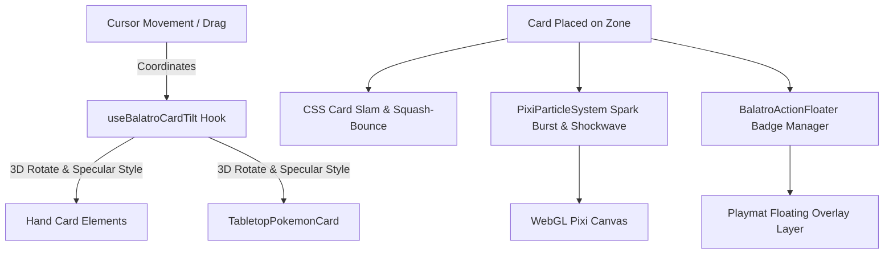

# Balatro-Style Full-Fledged Card Animation Suite Design

## 1. Overview & Vision
Bring the signature, ultra-satisfying tactile "juice" and physics-based punch of **Balatro** into PokéCount Tracker's playmat tabletop cards. Every card interaction will feel weighty, elastic, tactile, and visually thrilling—featuring dynamic 3D cursor tilt wobbling, holographic polychrome rainbow sheen, punchy "card slams" with squash-bounce upon play, and celebratory floating popup badges.

---

## 2. Core Feature Pillars

### 2.1 Dynamic 3D Cursor Tilt & Elastic Wobble (`Balatro Tilt Physics`)
- **Interactive Perspective**: When hovering any card (in Hand or on Active/Bench), the card tilts in 3D space (`perspective(800px) rotateX(...) rotateY(...) scale(...) translateZ(...)`) tracking the cursor's coordinate offset from the card's center.
- **Dynamic Specular Light Glint**: A localized radial sheen follows the cursor position over the card face (`radial-gradient(circle at X% Y%, rgba(255,255,255,0.4), transparent 60%)`), making the card feel physically glossy and tactile.
- **Elastic Spring Recovery**: On mouse leave or release, the card bounces back to rest with spring damping (`cubic-bezier(0.34, 1.56, 0.64, 1)`).

### 2.2 Juicy Card Play Slam & Squash-Bounce (`Card Play Juice`)
- **Action Trigger**: When a card is played from hand to Active, Bench, attached as Energy, or played as Trainer to Center Board.
- **Micro-Animation Stages**:
  1. **Anticipation Pop (0–60ms)**: Card elevates with scale `1.15x` and drop shadow expansion.
  2. **Heavy Slam Impact (60–160ms)**: Card snaps down with squash compression `scale(0.94, 0.96)`.
  3. **Elastic Overshoot (160–280ms)**: Snappy spring rebound `scale(1.04, 1.02)`.
  4. **Rest (280–360ms)**: Smooth settling at `scale(1.0)`.
- **Tabletop VFX Burst**:
  - WebGL shockwave ripple (`emitShockwave`) centered directly under the landed card.
  - Balatro-style multi-colored star sparks / chip confetti bursting outward from the landing spot.
  - Sound effect triggering tactile placement click (`Sound.playCardPlacement()`).

### 2.3 Balatro-Style Floating Badge Floaters (`Pop-up Action Badges`)
- When cards are played or activated, floating pill badges pop up with snappy bounce and drift upward before fading:
  - Attach Energy: `⚡ +ENERGY` (Amber/Gold glow)
  - Play to Active: `🌱 ACTIVE!` (Emerald glow)
  - Play to Bench: `✨ BENCH!` (Teal glow)
  - Evolution: `🔥 EVOLVED!` (Crimson/Orange glow)
  - Play Trainer: `🎴 TRAINER!` (Indigo glow)
  - Attack: `⚔️ ATTACK!` (Red/Amber glow)
- Rendered in stylish uppercase monospace typography with bold borders and colored neon drop shadows.

### 2.4 Rainbow Holographic & Polychrome Foil Shimmer (`Polychrome Foil`)
- Subtle iridescent holographic rainbow light sweep across cards:
  - On hover: Light sheen sweeps diagonally across the card surface.
  - On ex / Secret Rare / Ultra Rare / Promos: Enhanced polychrome rainbow chromatic shimmer (`linear-gradient(135deg, ...)`, `mix-blend-mode: color-dodge`).

### 2.5 Hand Card Spring Fanning & Magnetic Repel
- **Natural Fanning Arc**: Cards in the player's hand naturally rest along a gentle curved arc:
  - Center cards stand upright; edge cards tilt slightly outwards (`rotate((i - mid) * 2.5deg) translateY(abs(i - mid) * 2px)`).
- **Magnetic Spread on Hover**:
  - Hovering a card pushes neighboring cards slightly aside (magnetic separation), while the hovered card springs upward (`translateY(-20px) scale(1.15)`).

---

## 3. Architecture & Components

### Affected Files
1. `src/components/playmat-v3/hooks/useBalatroCardTilt.ts` (NEW):
   - Reusable hook calculating 3D perspective angles, specular shine coordinates, and spring exit transitions.
2. `src/components/playmat-v3/BalatroCardFloater.tsx` (NEW):
   - Floating badge manager for `+ENERGY`, `ACTIVE!`, `BENCH!`, `EVOLVED!`, `TRAINER!`.
3. `src/components/playmat-v3/TabletopPokemonCard.tsx` (MODIFY):
   - Integrate 3D Balatro tilt, holographic foil sheen, and play slam animation trigger.
4. `src/components/playmat-v3/PlaymatV3Canvas.tsx` (MODIFY):
   - Integrate hand card fanning arc, magnetic repel, tilt physics, and wire card-play action badges.
5. `src/components/playmat-pixi/engine/PixiParticleSystem.ts` (MODIFY):
   - Add `emitBalatroConfetti(x, y, color)` for celebratory card placement spark bursts.
6. `src/index.css` (MODIFY):
   - Add keyframes: `balatro-card-slam`, `balatro-foil-shimmer`, `balatro-badge-float`.

---

## 4. Performance & Mac 60 FPS Guarantees
- 100% GPU-accelerated CSS transforms (`transform: translate3d(...) rotateX(...) rotateY(...) scale(...)`).
- Zero DOM reflows / layout shifts (strictly `transform` and `opacity`).
- Pointer event throttling via `requestAnimationFrame` for buttery-smooth 60+ FPS on Mac Retina displays.
- Accessibility / Reduced motion support: gracefully respects `prefers-reduced-motion` by reducing tilt angles to standard subtle hover.

---

## 5. Verification Plan
- **Vitest Unit Tests**:
  - Test Balatro tilt angle calculations and bounds clamping $[-15^\circ, +15^\circ]$.
  - Test floater badge queue lifecycle and auto-dismissal.
  - Test `PixiParticleSystem.emitBalatroConfetti`.
- **Playwright Automated E2E (WebKit)**:
  - Test hand card fanning and hover tilt transformations.
  - Test playing a card from hand to Active/Bench triggers card slam class and floating action badge.
- **Quality Gates**:
  - `npm run lint`: 0 errors.
  - `npm test`: all unit tests pass.
  - `npm run build`: production bundle builds with 0 errors.
