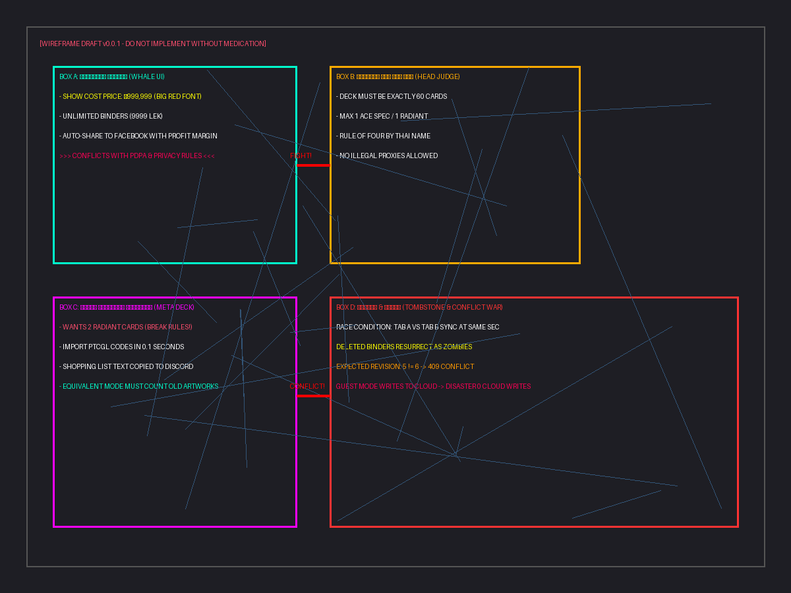
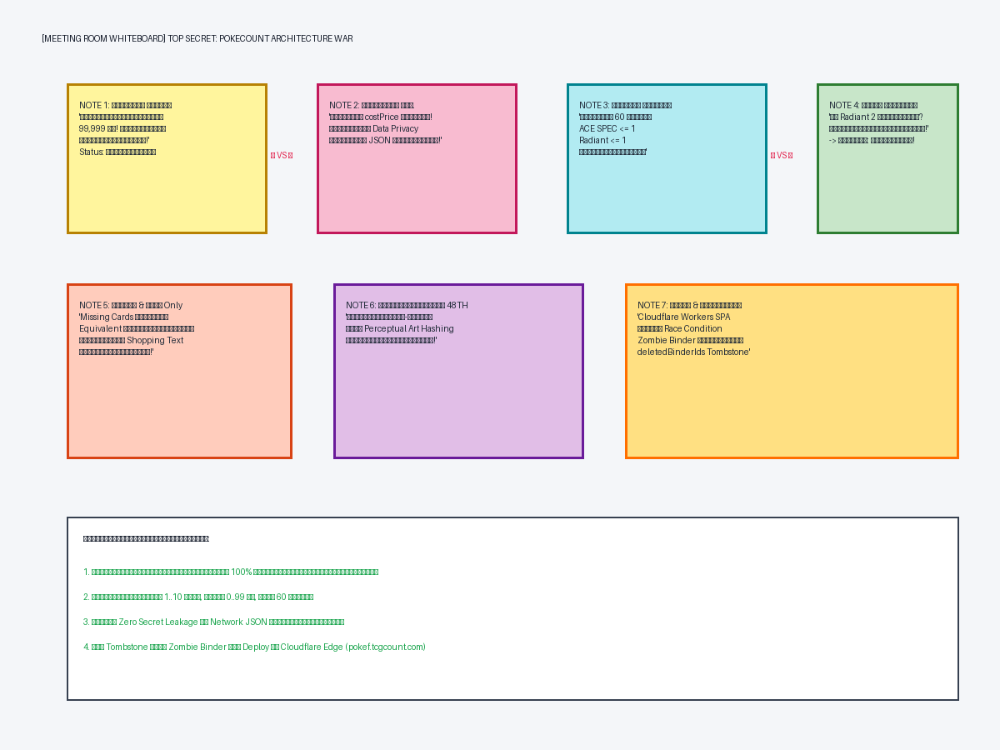
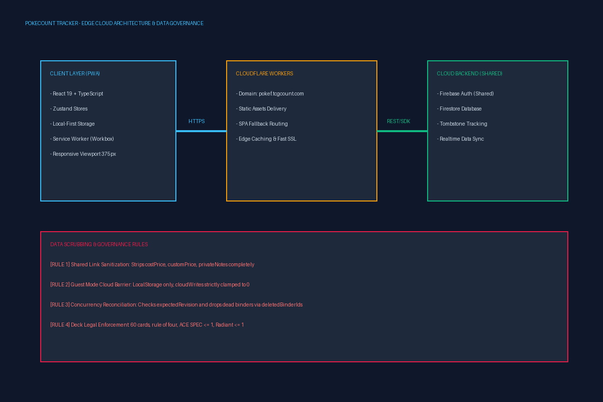

# บันทึกสัมภาษณ์พหุแหล่งข้อมูล · `PokéCount Tracker` (Multi-Source Interview Hub — รอบที่ 1)

> **จุดเด่นของชุดข้อมูลสัมภาษณ์นี้ (Multi-Source Evidence Triangulation & Rich Modalities)**:
> รวบรวมหลักฐานชั้นต้นหลากหลายรูปแบบ ทั้งเอกสารข้อความ, ไฟล์เสียงถอดเทปจริง, แชตแจ้งบั๊ก, ภาพถ่ายไวท์บอร์ดระดมสมอง, ภาพร่างพิมพ์เขียวสถาปัตยกรรม (Edge Cloud Architecture), และ Wireframe ร่างมือแบบสุดเว่อร์ที่ Requirements ตีกันมั่ว เพื่อจำลองสภาพความต้องการจริงก่อนการสังเคราะห์และส่งถามเจ้าของระบบใน [`interview/OWNER-ANSWERS.md`](OWNER-ANSWERS.md)

---

## 🗂️ สารบัญแหล่งข้อมูลต้นทางพหุรูปแบบ (`interview/sources/`)

| รหัสแหล่งข้อมูล | ไฟล์ต้นทาง | รูปแบบข้อมูล (Modality) | ผู้ให้ข้อมูล / แหล่งที่มา | สิ่งที่ได้จากแหล่งข้อมูลนี้ & ประเด็นที่ตีกัน |
|---|---|---|---|---|
| **`SRC-01`** | [`sources/01-field-interview-transcript.md`](sources/01-field-interview-transcript.md) | 🎙️ **ถอดเทปสัมภาษณ์สดพร้อม Timestamp** | คุณซาดิน (Owner), พรี่กฤษ ทรี แมน อัพ, พรี่เก่ง คนตื่น, สุมนา ยิ้มหน้า แม่เธอสิ, จาเมส, น้อง Only, จานบิน | ความต้องการหลัก 4 โมดูล, เพดานสมุดสะสม, เด็ค 60 ใบ, และความต้องการของนักสะสมสายวาฬที่อยากโชว์ราคาทุน |
| **`SRC-AUDIO`** | [`sources/audio/`](sources/audio/) | 🔊 **ไฟล์เสียงพูดจริง (Voice Recordings .m4a)** | • `01-field-recording-meen.m4a` (สุมนา ยิ้มหน้า แม่เธอสิ) • `02-voicemail-keng-whale.m4a` (พรี่เก่ง คนตื่น) • `03-expat-judge-hotline.m4a` (จาเมส) | เสียงบ่นเรื่องกฎที่ตีกัน: พรี่เก่งอยากเก็บการ์ด 9,999 ใบและโชว์ราคาทุน vs พรี่เควินสั่งห้าม, สุมนาอยากใส่ Radiant 2 ตัว vs พรี่กฤษสั่งแบน |
| **`SRC-IMG-01`** | [`sources/images/01-wireframe-chaotic-napkin.png`](sources/images/01-wireframe-chaotic-napkin.png) | 🎨 **ภาพสเก็ตช์ Wireframe สุดยุ่งเหยิง (Chaotic UI)** | ภาพร่างหน้าจอ UI จากกระดาษเช็ดปาก | ร่างกรอบ UI ของแต่ละคนที่ขัดแย้งกันอย่างรุนแรง (Whale UI vs Judge Rules vs Meta Deck vs Concurrency War) |
| **`SRC-IMG-02`** | [`sources/images/02-whiteboard-conflict-brainstorm.png`](sources/images/02-whiteboard-conflict-brainstorm.png) | 📋 **ภาพไวท์บอร์ดระดมสมอง (Sticky Notes Chaos)** | กระดานห้องประชุมชั้น 4 | บันทึก Post-it Note สีสดใสของแต่ละ Persona ที่ปะทะกัน (⚡ VS ⚡) และข้อสรุปสับขาหลอกที่ตัดระบบสั่งซื้อทิ้ง |
| **`SRC-IMG-03`** | [`sources/images/03-architecture-edge-flowchart.png`](sources/images/03-architecture-edge-flowchart.png) | 📐 **พิมพ์เขียว Edge Architecture & Governance** | พิมพ์เขียวระบบความปลอดภัย | ผังเชื่อมต่อ Client PWA -> Cloudflare Workers (`pokef.tcgcount.com`) -> Shared Firestore พร้อมกฎตัดข้อมูลต้นทุน 100% |
| **`SRC-02`** | [`sources/02-line-discord-bug-thread.md`](sources/02-line-discord-bug-thread.md) | 💬 **แชตกลุ่ม LINE OpenChat & Discord Log** | ชุมชนผู้เล่น Pokémon TCG Thailand | บั๊กสมุดผีคืนชีพ (`deletedBinderIds`), ข้อมูล Guest ไหลปนบัญชีจริงตอน Logout, และความปลอดภัย Zero Secret Leak |
| **`SRC-03`** | [`sources/03-partner-pricing-sheet.csv`](sources/03-partner-pricing-sheet.csv) | 📊 **ตารางสเปรดชีตราคาตลาด TCGPlayer (CSV)** | จานบิน มูลนิธิร่วมกันทำไม | ราคาการ์ด USD, อัตราแลกเปลี่ยน `34.00`, ตัวคูณความหายาก `thaiPriceRatio` (`0.60 / 0.85 / 1.10`), และการปัดเศษ `.50` |
| **`SRC-04`** | [`sources/04-tournament-deckcheck-rules.md`](sources/04-tournament-deckcheck-rules.md) | 📜 **ระเบียบกรรมการตรวจเด็คงานแข่ง Regional** | พรี่กฤษ ทรี แมน อัพ (Official Head Judge) | กฎเหล็ก 60 ใบ, Basic $\ge 1$, ชื่อไทยซ้ำ $\le 4$, `ACE SPEC <= 1`, `Radiant <= 1`, HP `30..340` |
| **`SRC-05`** | [`sources/05-incident-postmortems-v2.md`](sources/05-incident-postmortems-v2.md) | 🚨 **รายงาน Incident Post-Mortem (`v2.33.0` & `v2.42.1`)** | ทีมวิศวกรรม `PokéCount Tracker` | ประวัติบั๊กจริงเรื่อง `costPrice` รั่วในลิงก์แชร์ และกลไก `syncRevision` + `deletedBinderIds` |
| **`SRC-06`** | [`sources/06-user-survey-analytics.json`](sources/06-user-survey-analytics.json) | 📈 **ผลสำรวจนักสะสมไทย 120 คน (JSON Telemetry)** | แบบสำรวจผู้เล่นงานแข่ง | สถิติความต้องการ Missing Cards (`84.2%`) และสัดส่วนผู้ใช้จอมือถือ `375px` (`88.5%`) |

---

## 🖼️ แสดงตัวอย่างหลักฐานภาพถ่ายและแผนผังสถาปัตยกรรม

### 1. ภาพร่าง Wireframe สุดวุ่นวายที่ Requirements ตีกัน (`01-wireframe-chaotic-napkin.png`)

### 2. ไวท์บอร์ดจำลองสงคราม Post-it Notes ระดมความคิด (`02-whiteboard-conflict-brainstorm.png`)

### 3. พิมพ์เขียวสถาปัตยกรรมระบบ Edge Cloudflare & กฎคัดกรองข้อมูล (`03-architecture-edge-flowchart.png`)

---

## 👥 สรุปเสียงสะท้อนตามกลุ่มผู้ใช้งาน (Personas จากหลากมิติ)

### 1. คุณซาดิน (Product Owner & Lead Developer) · `[SRC-01, SRC-02, SRC-05]`
- เว็บ `PokéCount Tracker` มีฐานข้อมูลการ์ดไทย **9,554+ ใบ** และอังกฤษ **6,700+ ใบ**
- สมุดสะสม (`Binder`) สร้างได้ตั้งแต่ **1 ถึง 10 เล่มต่อบัญชี** (ห้ามลบเล่มสุดท้ายจนเหลือ 0 เล่ม)
- ช่องนับจำนวนการ์ดรับค่า **0 ถึง 99 ใบ** และแสดงช่องตามความหายากจริง (`Smart Variant System`)
- ลิงก์แชร์สมุดสะสมสาธารณะ `pk_xxxxxxxx` **ห้ามส่งออก `costPrice`, `customPrice`, และ `privateNotes` เด็ดขาด**

### 2. พรี่เก่ง คนตื่น (Whale Collector & Investor) · `[SRC-01, SRC-AUDIO, SRC-IMG-01]`
- มีสมุดสะสม 9 เล่ม มูลค่าพอร์ตสูงมาก ต้องการความมั่นใจ 100% ว่าราคาทุนจะไม่รั่วไหลไปใน Network Response
- อยากให้สมุดจุการ์ดได้ไม่จำกัดและโชว์ราคาทุนตัวใหญ่ๆ แต่ถูกระบบบล็อกไว้เพื่อความปลอดภัย

### 3. สุมนา ยิ้มหน้า แม่เธอสิ (Competitive Meta Player) · `[SRC-01, SRC-AUDIO, SRC-04]`
- ลอกลิสต์เด็คจาก PTCGL มาจัดเด็คไทย 60 ใบ
- ต้องการให้ระบบตรวจสอบเด็คผิดกฎ (ขาด/เกิน 60 ใบ, ขาด Basic Pokémon, ใส่ ACE SPEC หรือ Radiant เกินโควตา)
- ต้องการคำนวณการ์ดที่ขาด (Missing Cards) แบบ Equivalent (ใช้การ์ดชุดเก่านับแทนได้) พร้อมปุ่มคัดลอก Shopping List Text ไปแชร์ต่อ

### 4. จาเมส (Expat Player) · `[SRC-01, SRC-AUDIO, SRC-06]`
- ต้องการสลับภาษา `ไทย / English` บนหน้าเว็บ และค้นหาการ์ดไทยด้วยชื่อภาษาอังกฤษได้แม่นยำ

### 5. พรี่กฤษ ทรี แมน อัพ (Official Head Judge) · `[SRC-01, SRC-04, SRC-IMG-02]`
- ควบคุมกฎเหล็กการตรวจเด็คแข่งขัน 60 ใบ และกติกาการคำนวณดาเมจบนโต๊ะแข่ง (`ACTIVE` คิดจุดอ่อน $\times 2$ vs `BENCH` ห้ามคิดจุดอ่อน)

---

## ⚡ ตารางวิเคราะห์ข้อขัดแย้งข้ามแหล่งข้อมูล (Cross-Source Conflict Matrix)

| รหัสข้อขัดแย้ง | ประเด็นที่ตีกัน | ฝ่ายที่ 1 เรียกร้อง... | ฝ่ายที่ 2 เรียกร้อง... | การตัดสินชี้ขาดของระบบ |
|---|---|---|---|---|
| **CONF-01** | การแสดงผลราคาทุน (`costPrice`) ในลิงก์แชร์ | **พรี่เก่ง คนตื่น** อยากให้โชว์ราคาทุนในหน้าแชร์เพื่ออวดพอร์ตมูลค่าสูง | **พรี่เควิน เยส แห่งกนอ.** & ทีม Security สั่งห้ามเด็ดขาดเพื่อความปลอดภัยและ PDPA | **ตัดทิ้ง 100%**: ลิงก์สาธารณะต้องไม่มีฟิลด์ต้นทุนหลุดใน Network JSON แม้แต่ตัวเดียว |
| **CONF-02** | โควตาการ์ด Radiant ในเด็คแข่งขัน | **สุมนา ยิ้มหน้า แม่เธอสิ** อ้างว่าเด็คต่างประเทศอยากใส่ Radiant 2 ใบ | **พรี่กฤษ ทรี แมน อัพ** ยืนยันตามระเบียบสากล ห้ามเกิน 1 ใบเด็ดขาด | **ยึดกฎทางการ**: กำหนดเพดาน `Radiant <= 1` หากใส่ 2 ใบถือเป็นเด็ค Invalid |
| **CONF-03** | รูปแบบการค้นหาการ์ดที่ขาด (Missing Cards) | สมาชิกบางท่านคิดว่าต้องมีระบบสั่งซื้อในเว็บ | **จานบิน** และ **น้อง Only** ยืนยันว่าคนเล่นการ์ดต้องการแค่ 'Shopping List Text' ไปโพสต์หาของเอง | **ตัดระบบสั่งซื้อทิ้ง**: ทำเฉพาะระบบคำนวณการ์ดที่ขาด (Equivalent vs Exact) และปุ่มก๊อปปี้ Text ลง Clipboard |
| **CONF-04** | ขอบเขตการนับจำนวนการ์ดต่อช่อง | **พรี่เก่ง คนตื่น** เสนอให้กรอกได้ถึง 9,999 ใบ | สถาปัตยกรรมฐานข้อมูลและ UI กำหนดช่วงที่เหมาะสมคือ 0..99 ใบ | **จำกัด 0..99 ใบ**: หากกรอกเกิน 99 หรือติดลบจะถูกปฏิเสธด้วย `400 Out of Range` |
